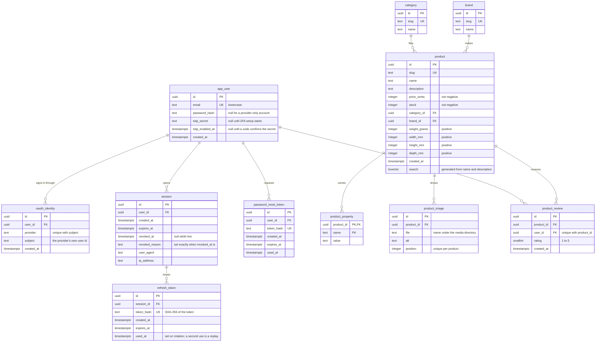

# Prism

A small business-to-consumer shop: accounts and a searchable catalog. The code does not know
what the shop sells. Every filter comes from the products' own properties at query time, so
the same code sells lamps, books or pet food.

Fastify API on Node, Postgres behind Drizzle, React storefront built with Vite and served by
Caddy. TypeScript end to end. Docker is the only thing a machine needs.

## Running it

```sh
./start.sh        # Linux and macOS
.\start.cmd       # Windows, from cmd or PowerShell
```

| Command | What it does |
| --- | --- |
| `./start.sh` | Copies `.env.example` to `.env` if there is none, then builds, migrates and starts everything, and seeds the shop. |
| `./start.sh --pull` | The same, and refreshes the base images. |
| `./start.sh down` | Stops the stack. |
| `./start.sh reset` | Stops it and deletes the database and the media. |
| `./start.sh seed` | Runs only the seed: placeholder products and a demo shopper, planted into an empty catalog. |
| `./start.sh test` | Runs every test suite in a container. |
| `./start.sh test npm run test:unit` | Runs only the unit tests there. |

On Windows each command is `.\start.cmd ...` with the same arguments.

| What | Where |
| --- | --- |
| Storefront | <http://localhost:3000> |
| API | <http://localhost:3000/api/v1> |
| Inbox for password-reset mail (Mailpit) | <http://localhost:8025> |

The stack needs no external accounts: the CAPTCHA uses Google's always-pass test key, the
provider buttons go to a built-in stand-in, and mail lands in Mailpit. Real keys go in `.env`;
`.env.example` describes each one. Its `JWT_SECRET` is public, so replace it anywhere but
your own machine.

The seed is separate from the shop: the shop runs without it, and a failed seed leaves an
empty shop. Its data is one archive, `apps/api/seed/data.zip`. After the seed, sign in as
`shopper@prism.test` with the password `correct horse battery staple`.
`apps/api/seed/README.md` has the details.

### Running it without the scripts

1. Copy `.env.example` to `.env`.
2. `docker compose up --build --detach`. If it fails, `docker compose logs migrate` says why.
3. Open <http://localhost:3000>. The storefront answers a few seconds after step 2 returns.
4. `docker compose down` stops the stack. Add `--volumes` to delete the data too.

Placeholder products: `docker compose run --rm --build seed`.

Tests: `docker compose run --rm --build test`. Append `npm run test:unit` for the unit tests
only.

### Working on it without the containers

Only development needs Node.

```sh
npm ci && npm run build                         # the shared package both apps import
npm run dev --workspace @prism/web              # storefront with hot reload, proxied to the running stack
npm run typecheck
npm run test:unit                               # unit tests of every workspace
npm test --workspace @prism/api                 # unit, integration and security; Docker running
```

## Usage

### Shopping

- **Categories**: the cards at the top. Picking one drops the other filters; picking it
  again clears it.
- **Search**: suggestions appear as you type. Submitting searches names and descriptions.
- **Filters**: brands, a price range, a minimum rating, and one group per property of the
  matching products, each value with its count. A value the other filters leave nothing for
  is grayed out, not removed.
- **Active filters** sit beside "Results", each with a cross. "Clear all filters" keeps the
  search text and the category.
- **Sort**: relevance, price either way, or rating.
- The filters live in the URL, so a filtered view is a link.
- A narrow screen puts the filters in a drawer.
- **Product page**: pictures, price, stock, brand, category, rating, description,
  properties, and weight and size in metric or imperial units.

### Accounts

- **Register**: email address, a password of at least twelve characters, and the CAPTCHA.
- **Sign in** with the password or a provider button. With no provider keys the button opens
  a stand-in consent page, where any address works.
- **Password reset**: "Forgot your password?" mails a link to the Mailpit inbox. Setting the
  new password signs every session out.
- **Two-factor authentication**: on the account page, scan the QR code with an
  authenticator app and confirm a code. Sign-in then asks for a code, and so does turning
  it off.
- **Change password** on the account page. A provider-only account can set one.
- **Sign out** revokes the session.

### The API

Every route is under `/api/v1` and answers JSON. A refusal is
`{ "error": { "code", "message", "issues" } }`, where `issues` names the rejected fields.
Authenticated routes take `Authorization: Bearer <access token>`.

| Method and path | What it does |
| --- | --- |
| `POST /auth/register` | Opens an account. Body: `email`, `password`, `captchaToken`. |
| `POST /auth/login` | Signs in. Answers a grant, or a challenge when 2FA is on. |
| `POST /auth/login/2fa` | Finishes a challenged sign-in with a code. |
| `POST /auth/refresh` | Trades the refresh cookie for a new access token and cookie. |
| `POST /auth/logout` | Revokes the session. |
| `GET /auth/me` | The signed-in user. |
| `POST /auth/password/forgot` | Sends a reset link. Answers the same whether the address exists. |
| `POST /auth/password/reset` | Sets a password against a token from the mail. |
| `POST /auth/password` | Changes, or sets, the password of the signed-in user. |
| `POST /auth/2fa/setup` | Starts enrollment: an `otpauth://` URI and a QR code. |
| `POST /auth/2fa/enable` | Confirms enrollment with a live code. |
| `POST /auth/2fa/disable` | Turns 2FA off with a live code. |
| `GET /auth/oauth/providers` | Which provider buttons to show. |
| `GET /auth/oauth/:provider` | Starts a provider sign-in. |
| `GET /auth/oauth/:provider/callback` | Where the provider returns. |
| `GET /products` | Searches the catalog. See the query keys below. |
| `GET /products/suggest?q=` | Names containing the typed text, those starting with it first. |
| `GET /products/:slug` | One product with its measurements in both unit systems. |
| `GET /media/:file` | A product image. |
| `GET /health` | Liveness. |

`GET /products` reads `q`, `category`, `brand`, `priceMin` and `priceMax` in cents, `rating`
as a minimum, `sort` (`relevance`, `price_asc`, `price_desc`, `rating`), `page`, `perPage`,
and `p.<name>=<value>` for any property. `brand` and `p.<name>` repeat: values under one key
are alternatives, and different keys all have to hold. The answer carries the page of items,
the total, and the facets.

## Entity relationship diagram

`||` is exactly one and `o{` is zero or more, read along the line: `app_user ||--o{ session`
means every session belongs to one user, and a user has any number of sessions.



The schema is `apps/api/src/db/schema.ts`, and the migrations under `apps/api/drizzle/` are
applied at start. Deleting a user or a product cascades to the rows that hang off it. A
category or brand with products refuses deletion.

## Design notes

- **Transactions.** Opening a session, rotating a refresh token and resetting a password
  each run in one transaction. One conditional `UPDATE` spends a reset link, so it works
  once however many requests carry it.
- **Constraints** are the quoted notes in the diagram.
- **Tokens.** The access token lives only in the tab's memory. The refresh token is an
  httpOnly cookie scoped to the auth routes. It rotates on every use, and a reused token
  revokes the session.
- **Search.** `product.search` is a generated `tsvector` under a GIN index, name weighted
  above description, matched with `plainto_tsquery` and ranked with `ts_rank`. The name also
  matches as a substring.
- **Facets.** The category facet counts the whole shop. Every other facet counts its values
  under every filter except its own.
- **SQL.** Every value a shopper supplies is a bound parameter.
- **Images.** Files in the `MEDIA_DIR` volume, named by `product_image.file` and served at
  `/media/` by `@fastify/static`.

## Testing

```sh
./start.sh test                       # every suite of every workspace, in a container
./start.sh test npm run test:unit     # only the unit tests, in the same container
```

This needs only Docker. The integration and security suites run the real application on a
real Postgres, started through Testcontainers. Only the clock, the mailer and the password
hasher are substituted. CI runs every suite before each deploy.

| Suite | Where | Covers |
| --- | --- | --- |
| Unit | `apps/api/tests/unit`, `packages/shared/tests`, `apps/web/tests` | JWT creation, verification and expiry; input schemas; product conversions; the search SQL and its bindings; URL filter arithmetic |
| Integration | `apps/api/tests/integration` | Every auth and catalog endpoint |
| Security | `apps/api/tests/security` | Injection, forged tokens, mass assignment, path traversal, rate limiting, script payloads |

Checked by hand, because a third party's screen is involved: the CAPTCHA, a provider sign-in
with real Google or GitHub keys, and 2FA enrollment with a phone app.

## Deployment

`.github/workflows/deploy.yml` typechecks, runs every test suite, builds both images, pushes
them to the GitHub container registry, and restarts the stack on a server over SSH with
`docker-compose.prod.yml` over `docker-compose.yml`. The host, ports, public URL and
credentials are secrets and variables of the repository's `production` environment, which
only `main` can deploy to; `.env.example` lists them. A Deploy run started by hand from the
Actions tab offers a box that rebuilds the database from the migrations, deleting every
account, product and review. `.github/workflows/seed.yml`, also started by hand, seeds an
empty catalog in the running shop without a deploy.
