# Prism

**A business-to-consumer storefront that sells colors.** Not paint — colors. Each SKU is a
single hue, sold as itself: `Screaming Pumpkin`, `Municipal Beige`, `Void Black`. Brands
are pigment foundries.

There are three categories, and they have almost nothing in common:

| Category | What it is | What it carries |
| --- | --- | --- |
| **Colors** | A color, sold whole | A hex, and three amounts of finish |
| **Finishers** | Puts a finish back on a color you own | One of those amounts, being the one thing the finisher does |
| **Shifters** | Turns a color you own into a different one | A direction round the wheel, and an arc in degrees |

The unusual product turns out to be a good fit for the requirements. A color has real
numeric attributes — hue angle, saturation, lightness — which makes faceted search
genuinely interesting rather than a brand checkbox, and it means every image in the shop can
be generated at seed time instead of committed as binaries. A color gets one swatch of
itself. A finisher holds no color, so what there is to show is the effect: the thing it does,
then the same thing done to four ordinary pigments — five pictures rendered from the one
number the finisher carries. A shifter changes no surface, so it has no picture and the grid
draws it from its own two numbers.

Three categories with disjoint attributes is the interesting modeling problem here, and it
is solved the normalized way: a `product` table for what all three share, and a `color`,
`finisher` and `shifter` table for what they do not. A column only exists where it applies,
so there is no `hex` on a shifter to be null. `finisher` is the one table with a choice
inside it — a finisher does one thing, so exactly one of its three amounts is present and a CHECK
refuses any row where that is not true. Each keys back to `product (id, kind)` rather than
to `product (id)`, so a color row
attached to a shifter is rejected by the database rather than by a code path somebody has to
remember to write. [`spec.ts`](apps/api/src/modules/catalog/spec.ts) is the one place that
turns the joined row back into a discriminated union, after which nothing downstream sees a
null.

The required weight and dimensions belong to the thing itself rather than to a container,
because there is no container — and what there is to measure follows from what the thing is:

| | Colors | Finishers | Shifters |
| --- | --- | --- | --- |
| | **Temperature** how warm it burns · °C / °F | one of **Grain** how much texture it leaves · µm / mil | **Torque** how hard it has to turn · N·m / lbf·ft |
| | **Reach** how far away it still reads · m / ft | **Coating** the layer it lays down · nm / µin | **Backlash** the play before the color moves · mm / in |
| | **Coating** the interference layer over it · nm / µin | **Reach** how far the glow it leaves carries · m / ft | |
| | **Weight** how heavy it looks · g / oz | **Weight** the solids it carries · g / oz | **Weight** the gear itself · g / oz |

Weight is the one all three share, because the requirement names it and because everything
in the shop has some. A finisher quotes one dimension and it is the one its own effect has: one sold
for the surface it leaves quotes that surface's grain, one sold for a coating quotes
the film's thickness, one sold for a glow quotes how far the glow carries. Otherwise a kind
measures exactly what it carries — a finisher never runs out, so there is nothing to measure
about how long it lasts.

The coating is where the two systems stop being the same number under a different name. It
is a layer a few hundred nanometers thick, which is below the mil every other surface in the
shop is quoted in, so the imperial half drops three decimal places to the **microinch** —
25.4 nm, the same ratio as the mil, and the unit an inch-shop measures a coating in.

Every one is a generated column, so `hex`, the three finish amounts, `arc_degrees` and
`direction` are the only stored facts about any product. Kelvin is what the temperature
column holds, being the unit the derivation is defined in, and nothing displays it: "6208 K"
describes a light source rather than a color.

**Every word resolves against what a product is.** Adding a color says what the color *is*,
and nothing else — no taxonomy, no label, no shelf chosen by hand.
`shifters` is a category, `cw` and `clock-wise` are a direction, `iridescent` is a stretch of the
roughness axis, and `gold` is a point in RGB space — every color belongs to the landmark
nearest it, which partitions the color cube into one Voronoi cell per name. `color_family`
holds those landmarks and a generated column holds the answer, so the family is indexed and
countable without anyone having decided that this particular color is a gold.

This is **Project 1 (Foundation)**: accounts, the database, and the catalog.

---

## Running it

**Docker is the only prerequisite.** No Node, no Postgres, no accounts anywhere.

```bash
./start.sh
```

That builds the images, starts the stack, sets up the database, seeds the catalog —
every color with its swatch, every finisher with the five pictures of what it does, and the
shifters beside them — and waits until the storefront answers.

| Service | URL |
| --- | --- |
| Storefront | <http://localhost:3000> |
| API documentation | <http://localhost:3000/api/docs> |
| Inbox (Mailpit) | <http://localhost:8025> |

Two accounts are seeded, both with the password `colors are not paint`:

| Email | Role |
| --- | --- |
| `admin@prism.test` | admin |
| `shopper@prism.test` | customer |

```bash
./start.sh down     # stop
./start.sh reset    # stop and delete the volumes
```

The database keeps a checksum of every migration it applied. If one of those files is
edited afterward, the stack refuses to start and names the file, because the schema it
holds is not the one the code expects. `./start.sh reset` builds it again from the files,
keeping only what the seed creates.

### Editing the storefront while it runs

`./start.sh` serves a built image, so a change to the source is picked up the next time it
builds. To see one immediately:

```bash
npm run dev --workspace @prism/web    # http://localhost:5173
```

That serves the storefront from source with hot reloading and hands `/api` and `/media` to
the stack already running on port 3000, so the database, the sessions and the uploaded media
are the same ones. Cookies are scoped to a host and not to a port, so a session signed in on
3000 is signed in here too. Nothing else has to be running for it, and nothing about the
stack has to be restarted afterward.

### Why it needs no secrets

CAPTCHA and OAuth would normally need a Google Cloud account, which would make "Docker is
the only prerequisite" false. Both default to a mode that works offline:

- **CAPTCHA** renders the genuine reCAPTCHA widget using Google's published always-pass
  test key pair. The widget is real and the server-side check is real; the key is the one
  Google provides for exactly this situation.
- **OAuth** runs the full authorization-code flow — for both Google and GitHub — against a
  consent screen this API serves itself. The redirect, the `state` check, the code
  exchange, the profile lookup and the account linking are all real; only the identity
  provider is local. Each provider signs its own authorization codes, so a code minted for
  one is rejected by the other, exactly as two real providers behave.

Set real credentials in `.env` and the same code paths verify against the real thing.
There is no mode to set beside them: a credential's presence is what turns its path on, so
the two cannot be made to disagree — no mode naming a key that is absent, and no key left
unused behind a mode that ignores it.

```ini
RECAPTCHA_SITE_KEY=...
RECAPTCHA_SECRET_KEY=...

GOOGLE_CLIENT_ID=...
GOOGLE_CLIENT_SECRET=...
GITHUB_CLIENT_ID=...
GITHUB_CLIENT_SECRET=...
```

In `live` mode a provider is offered only when **both** halves of its credential pair are
set, so configuring GitHub alone is a valid setup — the sign-in page asks
`GET /auth/oauth/providers` and renders only the buttons that can actually work.

Authorized redirect URIs:

```text
http://localhost:3000/api/v1/auth/oauth/google/callback
http://localhost:3000/api/v1/auth/oauth/github/callback
```

Two-factor is enforced on **every** path. A provider proves who owns the third-party
account, not that the second factor this account asked for was satisfied — and since a
provider reporting a matching verified address links itself, that is not a bar the owner
controls. An OAuth sign-in into an account with TOTP lands on the same challenge page
password sign-in uses, with the token in an httpOnly cookie rather than the URL.

Password-reset email goes to the **Mailpit** container, a local inbox at
<http://localhost:8025> — not to a real address. Set `SMTP_HOST`, `SMTP_USER`,
`SMTP_PASSWORD` and `SMTP_SECURE` in `.env` to send through a real relay.

The GitHub app needs the `read:user` and `user:email` scopes. Without `user:email` the
emails endpoint returns 403 and any account with a private address cannot sign in at
all — GitHub's `/user` returns `email: null` for those, which is the default for many
accounts.

### Tests

```bash
npm test              # everything
npm run test:unit     # the fast ones only
npm run test:e2e      # Playwright, against the running stack
npm run typecheck
```

The integration tests start a real Postgres via Testcontainers, so Docker must be running.
The end-to-end specs drive a real browser and expect `./start.sh` to have been run first.

---

## Deployment

Pushing to `main` builds the commit and restarts it on whichever server the
repository's settings point at. Nothing here names a host — the address, paths,
ports and credentials are all GitHub variables and secrets, listed in
[`.env.example`](.env.example).

A server small enough to be cheap runs this stack and cannot build it, so the
runner builds both images, pushes them to GHCR tagged with the commit SHA, and
the server pulls and restarts. Rolling back needs no rebuild: point `.env` at an
older tag and `up -d`.

The migrations and the seed run first, on their own. If they fail, or the runner
refuses the database because a migration it applied was edited afterward, the
deploy stops there with the runner's output in the log, and the version already
running keeps serving. A refusal is settled by running the workflow by hand with
**Rebuild the database** ticked. That is the server's `./start.sh reset`: the
database and the uploaded media are deleted, and the start builds both again
from the migrations and the seed.

Host side, there are two things: a `docker` group for the deploy account, and a
proxy block pointing the subdomain at `WEB_PORT`.

---

## Entity relationship diagram

Cardinality is on the connector; modality is in the notes beneath.

```mermaid
erDiagram
    APP_USER ||--o{ OAUTH_IDENTITY : "signs in with"
    APP_USER ||--o{ SESSION : "opens"
    APP_USER ||--o{ PASSWORD_RESET_TOKEN : "requests"
    APP_USER ||--o{ PRODUCT_REVIEW : writes
    SESSION  ||--|{ REFRESH_TOKEN : "rotates through"

    BRAND    ||--o{ PRODUCT : produces
    PRODUCT  ||--o| COLOR : "is a"
    PRODUCT  ||--o| FINISHER : "is a"
    PRODUCT  ||--o| SHIFTER : "is a"
    PRODUCT  ||--o{ PRODUCT_IMAGE : "is shown by"
    PRODUCT  ||--o{ PRODUCT_REVIEW : "is rated by"

    APP_USER {
        uuid        id              PK "gen_random_uuid()"
        text        email           UK "lowercase, CHECK enforced"
        text        password_hash   "NULL for OAuth-only accounts"
        user_role   role            "customer | admin"
        text        totp_secret     "NULL until 2FA setup begins"
        timestamptz totp_enabled_at "NULL until a live code confirms it"
        timestamptz created_at
    }

    OAUTH_IDENTITY {
        uuid        id       PK
        uuid        user_id  FK
        text        provider UK "unique with subject"
        text        subject  UK "provider's immutable id, never the email"
        timestamptz created_at
    }

    SESSION {
        uuid        id             PK "carried in the access token as sid"
        uuid        user_id        FK
        timestamptz expires_at
        timestamptz revoked_at     "NULL while live"
        text        revoked_reason "logout | token_reuse | password_reset"
        text        user_agent
        text        ip_address
        timestamptz created_at
    }

    REFRESH_TOKEN {
        uuid        id         PK
        uuid        session_id FK "the rotation family"
        text        token_hash UK "SHA-256; the token itself is never stored"
        timestamptz used_at    "NULL until spent; non-NULL twice means replay"
        timestamptz expires_at
        timestamptz created_at
    }

    PASSWORD_RESET_TOKEN {
        uuid        id         PK
        uuid        user_id    FK
        text        token_hash UK
        timestamptz used_at    "NULL until spent; single use"
        timestamptz expires_at
        timestamptz created_at
    }

    BRAND {
        uuid     id            PK
        text     slug          UK
        text     name
        text     description
        tsvector search_vector "GENERATED"
    }

    PRODUCT {
        uuid         id             PK
        text         slug           UK
        text         name
        text         description
        integer      price_cents    "CHECK >= 0"
        integer      stock_quantity "CHECK >= 0"
        uuid         brand_id       FK
        product_kind kind           "the discriminant: color | finisher | shifter"
        tsvector     search_vector  "GENERATED, name weighted above description"
        timestamptz  created_at
    }

    COLOR {
        uuid     product_id         PK "FK with kind, so it can only be a color"
        text     hex                "CHECK matches #rrggbb"
        smallint roughness          "5 mirror .. 95 chalk"
        smallint coating_nanometers "interference layer, or 0 for bare paint"
        smallint emission           "how hard it glows, or 0"
        smallint hue                "GENERATED from hex"
        smallint saturation         "GENERATED from hex"
        smallint lightness          "GENERATED from hex"
        text     family             "GENERATED; nearest landmark in RGB space"
        smallint temperature_kelvin "GENERATED"
        integer  reach_centimeters  "GENERATED"
        integer  weight_grams       "GENERATED"
    }

    FINISHER {
        uuid     product_id         PK "FK with kind, so it can only be a finisher"
        smallint roughness          "the surface it leaves, or absent"
        smallint coating_nanometers "the layer it lays down, or absent"
        smallint emission           "the glow it leaves, or absent"
        smallint grain_micrometers  "GENERATED from roughness"
        integer  reach_centimeters  "GENERATED from emission"
        integer  weight_grams       "GENERATED"
    }

    SHIFTER {
        uuid            product_id                PK "FK with kind, so it can only be a shifter"
        shift_direction direction                 "cw | ccw"
        smallint        arc_degrees               "CHECK between 1 and 360"
        integer         torque_millinewton_meters "GENERATED"
        integer         backlash_micrometers      "GENERATED"
        integer         weight_grams              "GENERATED"
    }

    PRODUCT_IMAGE {
        uuid        id         PK
        uuid        product_id FK
        text        filename   "SHA-256 of the bytes plus extension"
        text        alt
        integer     position
        timestamptz created_at
    }

    PRODUCT_REVIEW {
        uuid        id         PK
        uuid        product_id FK "unique with user_id: one review each"
        uuid        user_id    FK
        smallint    rating     "CHECK between 1 and 5"
        text        body
        timestamptz created_at
    }
```



**Modality.** Every foreign key above is mandatory. A `session` need not have a
`revoked_at`; a `refresh_token` need not have a `used_at`; an `app_user` need not have a
`password_hash` (OAuth-only) or a `totp_secret` (2FA off). Each of those is mapped to an
`Option` at the repository boundary, so nothing above that layer sees a `null`.

A column only exists in the table it applies to, so there is no `hex` on a shifter to be
null. `finisher` is where absence is the point rather than an accident: a finisher does one
thing, so it carries one of the three amounts and leaves the other two absent, and which
one is present is what the finisher *is*. A CHECK says exactly that, and it is the reason a query
for the iridescent finishers is a query for the rows that have a coating at all:

```sql
CONSTRAINT finisher_does_one_thing CHECK (
  num_nonnulls(roughness, coating_nanometers, emission) = 1
)
```

What the database also has to say is that a variant row belongs to a product of its own
kind, and a plain foreign key on `product_id` cannot say it — so the key is composite:

```sql
CREATE TABLE color (
  product_id uuid         PRIMARY KEY,
  kind       product_kind NOT NULL DEFAULT 'color',
  …
  CONSTRAINT color_is_a_color CHECK (kind = 'color'),
  FOREIGN KEY (product_id, kind) REFERENCES product (id, kind) ON DELETE CASCADE
);
```

`product` carries `UNIQUE (id, kind)` for those three keys to point at. A color row attached
to a shifter is rejected by the database rather than by a code path somebody has to remember
to write.

**Cardinality.** A session has *at least one* refresh token (`||--|{`) — it is created
with its first one in the same transaction, because a session with no token is unusable.
Everything else is zero-or-more.

### One view, no stored aggregates

There is no `rating_avg` or `rating_count` column. A view owns the aggregation and every
catalog read goes through it:

```sql
CREATE VIEW product_listing AS
SELECT p.*, b.name AS brand_name,
       c.hex, c.family, s.direction, s.arc_degrees,
       COALESCE(c.roughness, f.roughness)                       AS roughness,
       COALESCE(c.weight_grams, f.weight_grams, s.weight_grams) AS weight_grams,
       COALESCE(AVG(r.rating), 0)::numeric(3,2) AS rating_average,
       COUNT(r.id)::integer                     AS rating_count
FROM product p
JOIN brand b ON b.id = p.brand_id
LEFT JOIN color c ON c.product_id = p.id
LEFT JOIN finisher f ON f.product_id = p.id
LEFT JOIN shifter s ON s.product_id = p.id
LEFT JOIN product_review r ON r.product_id = p.id
GROUP BY p.id, b.id, c.product_id, f.product_id, s.product_id;
```

The view is also where a search stops caring which table a column lives in. The three finish
amounts are `COALESCE`d across the two kinds that have them, so one filter on roughness
finds it wherever it is.

A displayed rating therefore cannot disagree with the reviews it came from. If aggregation
ever costs too much, `CREATE MATERIALIZED VIEW` is the only word that changes — no
application code moves.

The same principle appears three times with three mechanisms:

| Derived value | Mechanism | Why that one |
| --- | --- | --- |
| Ratings | SQL view | Aggregates across rows; only the database can |
| Hue / saturation / lightness | `GENERATED ALWAYS … STORED` | Must be **indexable** for range faceting, so it has to be materialized — but Postgres owns the derivation, not the app |
| Color family | `GENERATED ALWAYS … STORED` | Same reason: searching for "gold" is a `WHERE family = 'gold'` against an index, and nobody ever files a color under a name |
| Temperature / reach / weight | `GENERATED ALWAYS … STORED` | Same reason, and it leaves the variant columns as the only stored facts about any product |
| Imperial units | Pure TypeScript function | Presentation only; never filtered or sorted on |

Every measurement lives in the table of the kind that has it, generated from that kind's own
columns. Weight is the one all three carry, and each derives its own: a color's from its
lightness, a finisher's from the solids it must hold, a gear's from its arc. Nothing dispatches on
`kind` any more, because nothing has to.

Each is stored in the smallest whole unit — centimeters, millinewton-meters, micrometers,
nanometers — so the columns stay exact integers. Scaling to a readable unit is presentation,
and happens in `@prism/shared` alongside the imperial conversion.

---

## Architecture

A **modular monolith** with ports and adapters inside. One deployable API, split into
modules that own their tables. Projects 2 and 3 arrive as new modules, not a rewrite.

```text
apps/api/src/
  main.ts        process entry: config, database, listen, graceful shutdown
  app.ts         the composition root — the only file that knows which
                 adapter implements which port
  config.ts      environment parsed once by Zod; a bad container dies at boot
  platform/      ports and their adapters
                 clock · hasher · tokens · mailer · captcha · oauth · storage · cache
  http/          errors · cookies · guard
  modules/
    auth/        routes | service | repository | emails | mock-consent
    catalog/     routes | service | repository | search
  db/            schema · migrate · seed · palette · swatch · finish-art

packages/shared/ Option · Result · units · color · errors · Zod contracts
apps/web/        React SPA
```

Services never import a concrete adapter. They receive `{ clock, hasher, tokens, repo }` as
an argument, which is what lets the tests run the real logic against a fake clock and an
in-memory mailer, and what lets `createAuthService` be reused wherever its adapters are
supplied.

### The stack

| Layer | Choice |
| --- | --- |
| Runtime | Node 26 — runs TypeScript directly via native type stripping, so the API has **no build step** |
| Language | TypeScript 7 (the native compiler), `strict` plus `noUncheckedIndexedAccess` and `exactOptionalPropertyTypes` |
| HTTP | Fastify 5 with `fastify-type-provider-zod` |
| Database | PostgreSQL 18, Drizzle ORM 0.45, hand-written SQL migrations |
| Errors | `neverthrow` `Result<T, DomainError>` — no `throw` in domain code |
| Matching | `ts-pattern`, including all JSX conditionals |
| Frontend | React 19, Vite 8, Tailwind 4, React Router 8 (data mode), TanStack Query |
| Web server | Caddy |
| Tests | Vitest 4, `fastify.inject`, Testcontainers |

### Types carry the rules

`packages/shared` defines the vocabulary the whole codebase speaks:

```ts
type Option<A> = { _tag: "Some"; value: A } | { _tag: "None" }

type DomainError =
  | { _tag: "InvalidCredentials" }
  | { _tag: "RefreshTokenReused" }
  | { _tag: "ValidationFailed"; issues: readonly ValidationIssue[] }
  | …
```

The repository layer is the only place that sees a nullable column. Every service returns
`Result<T, DomainError>`, and the HTTP layer maps the error tag to a status code through a
`Record<DomainErrorTag, number>` — a record keyed by the tag union is exhaustive by
construction, so **adding an error variant is a compile error until every layer handles
it**.

There are no `as` casts anywhere in the codebase. `unknown` appears only in type
predicates at genuine parse boundaries — JWT payloads, Fastify's error handler, OAuth
provider responses, and the `grecaptcha` global — where the value really is unknown until
checked.

### Drawing a color

A color has two stored facts, and a flat rectangle of hex states only one of them. The other
is three **amounts**, rolled independently, because a real surface is several things at once:

| Amount | Range | What it means, and what the slab does |
| --- | --- | --- |
| `roughness` | 5–95 | How scattered the surface is. Low is lacquered: a clearcoat over the pigment returns the strip lamp as a broad soft band. High is chalk — no band at all, a sheen lobe, and visible relief. A mirror and a wall of chalk are the two ends of this one axis, which is why they share it |
| `coating` | 0, or 100–600 nm | The thickness of a transparent interference layer over the paint. Not a color and not an arc: the thickness *is* the color, and everything the layer does follows from it |
| `emission` | 0, or 35–100 | How hard the pigment gives off its own light, on top of the light it returns rather than instead of it |

None of the three says what the color *is*. A color can be lacquered and iridescent at once,
which real paint routinely is. The three words — `roughness`, `iridescent`, `fluorescent` —
are how the shop talks about itself, but they are **readings** of the numbers rather than
values anything stores: `FINISH_BANDS` maps each word to the stretch of one amount it names,
so typing "iridescent" into the search box lands somewhere sensible.

So a color is narrowed by the amounts rather than by the words, and by all three at once:
three sliders, live together, because narrowing one says nothing about the other two. A
shopper can ask for a lacquered surface that is also coated and also glowing, which is a
thing real paint is. The roughness slider spans the whole axis and a shopper drags toward
whichever end they mean, rather than the shop picking the point where a mirror becomes
chalk. The sliders carry no counts, because a range has no buckets to distort.

The three words belong to the finishers, and that is the whole of a finisher's filter. A
finisher does one thing, so it has one answer to which finish it is, and the word is a
question about which column its row has: asking for the iridescent finishers is asking which
rows carry a coating at all. No threshold recovers it and nothing has to agree about where
one finish becomes another. Each word names a different amount, so the three of them cannot
overlap however wide each one is.

There is no such thing as *the* roughness finisher: one finisher leaves a surface at 20 and
the next at 15, and a shopper who wants the second is not served by being sold the first. So
the word is only half the question. Choosing one opens a slider for the amount that word
names — percent for a grain, nanometers for a coating, percent again for a glow — running
the stretch of that axis the word covers and no further, so there is no part of the track a
thumb can be dragged into that answers with nothing. Choosing a different word clears the
range with it: a range says where on one axis to look, and the next word names a different
axis. The counts beside the three words ignore the range for the same reason, so a shopper
who has narrowed one of them can still see how many of the other two there are and switch.

[`surfaces.ts`](apps/web/src/features/catalog/artwork/surfaces.ts) is where those amounts
become rendering parameters, and every one of its outputs is a **continuous** function of
its input: two colors a point apart render a point apart. That is the property the unit
tests are built around, because a band anywhere in that function is a place where a filter
returns two colors whose pictures disagree about what they are.

**One WebGL context draws the whole page.** A browser will not hand a dozen contexts to one
document, so there is exactly one renderer, one scene, one slab and one material — with
every shader feature it can use switched on permanently at a value near zero, because
three's program key is built from which of them are above zero and a material that turned
one off between two colors would compile a second shader mid-scroll. Only one stage is ever
under the pointer; the others are still pictures holding whatever was last drawn on them.

**The room is a room.** A gloss face is a picture of its surroundings, so a scene with
lights and nothing to reflect renders as plastic. `PMREMGenerator` convolves a small scene
of bright panels — including the strip, on the same line as the real one, because it is the
same lamp — into the environment every material samples. On top of that: a key light for
shape and a soft shadow; a `RectAreaLight` for the strip itself; and a hemisphere light for
fill, which contributes irradiance and no highlight of its own.

Where that lamp goes is not a matter of taste. A flat face reflects whatever is directly
behind the viewer and spans about seven degrees of that reflection, so a lamp further round
than that cannot appear on a slab standing square on at any brightness — which would leave a
lacquered color reading as matte in a grid nobody has hovered.

**Fluorescence is absorption and re-emission**, so a pigment that fluoresces is an ordinary
lit surface that also adds: it keeps its shading, its highlight and its edges, and its own
band comes back stronger than it went in. Two things follow. The albedo is that band at full
strength — a pigment fluoresces in a narrow band and returns nearly all of it, which is why
one is never dark whatever hue it is sold as. And a pigment with no band has none to hand
back: gray does not glow gray, it goes white, so an emission is only allowed on a hex
saturated enough to have a band, and `product_fluorescence_needs_a_band` says so in the
database rather than in a comment.

The amount is a claim about brightness, so it is spent as luminance and not as energy. A
saturated yellow at the top of its band carries four times the luminance of a saturated
violet at the top of its, and `emissiveScale` divides that out — without it an emission of
60 is legible on the top half of the wheel and does nothing on the bottom. Measured on one
violet with the glow switched off and on: the same face reads 93 mean luminance against 159,
a lift of seven tenths.

**The spill has a ceiling.** A bloom is the display admitting it has run out of range, and
one wide enough to reach the wall says instead that the room is that color — the background
takes the pigment's hue, the slab loses its edge, and a shelf of glowing colors is painful
to look at. So the radius is small and the strength smaller, and the bound is checked rather
than eyeballed: in the dark room the background behind every glowing color stays under 20%
lightness, against a non-glowing control that sits around 8%. In the lit room, where the
wall is gray to begin with, what is bounded is color rather than brightness: the background
stays under 12% saturation, so it stays the gray it was.
[`catalog-artwork.spec.ts`](e2e/specs/catalog-artwork.spec.ts) measures every card on the
shelf and fails on either.

**Neutral tone mapping, because the color is the product.** ACES is the usual default and it
desaturates exactly the saturated colors this shop is selling. Under Khronos PBR Neutral,
which compresses highlights and leaves the rest alone, a face turned to the camera comes
back within single digits of 255 per channel of the hex it is sold under, measured across
every color whose finish is its surface. A coating is meant to disagree, because a layer
that handed back the paint's own color would not be a coating; so is a glow, because a
pigment that makes its own light is brighter than the hex it is mixed from.

**The coating is a real layer, and its thickness is the whole model.** Light coming back off
the top of the layer meets light coming back off the paint underneath, having gone twice
through it; the wavelengths that arrive in step are the ones you see, and which those are
depends on the thickness, the refractive index and the angle. Nothing about the color is
stored, because nothing about it is a separate fact — three.js implements
[Belcour and Barla's](https://belcour.github.io/blog/research/publication/2017/05/01/brdf-thin-film.html)
thin-film model and is handed the one number the shop sells.

Two things follow from taking that seriously, and both were found by rendering rather than
by reasoning. The layer is **titanium dioxide**, index 2.4, which is what every interference
pigment ever sold is actually built from — a layer whose index matched the paint under it
would be no layer at all, and a first attempt at an oil-like 1.45 over a 1.5 base rendered
as bare paint, correctly and uselessly. And a coating needs a **reflection to happen in**, so
`product_coating_needs_a_reflection` keeps every coated surface smooth: interference over
chalk is invisible, and a shop that sold it would be charging for nothing.

Swept on one near-black slab, the color walks the series a soap film walks — 100 nm warm
brown, 175 nm olive, 250 nm cyan, 325 nm magenta, 400 nm green — and starts again paler each
time it passes another order, which is why the range stops at 600. Turning the slab from one
side to the other swings the hue by 15–36°, measured across four coatings. A saturated
pigment shows much less of any of this than a dark one does, because interference lives in
the reflection and a bright pigment's own color is louder than it.


The split is the same one the rest of the codebase uses.
[`tilt.ts`](apps/web/src/features/catalog/artwork/tilt.ts) and `surfaces.ts` are arithmetic,
pure and unit-tested and unaware that a GPU exists;
[`gl.ts`](apps/web/src/features/catalog/artwork/gl.ts) holds the renderer, the composer and
the environment, and `scene.ts` builds the slab's room on top of it. Those two are where
referential transparency stops, because a GPU context is a resource rather than a value. The component between them owns a canvas, turns the pointer into an angle, and
runs the frames — none of it through React state, because re-rendering a card's subtree
sixty times a second to move a number no React tree reads is not what React is for.

A browser with no WebGL2 gets the flat swatch instead, and so does one whose "GPU" is really
the CPU — a grid of flat swatches that arrives at once is a better page than a grid of lit
ones that arrives two seconds late. Which machines those are, and how a visitor overrules
the answer, is the switch described below.

### Drawing a finisher

A finisher holds no color, so a slab of one would be a slab of nothing. What it sells is
what it *does* to a color, so that is what its pictures show — the effect itself, then the
same effect over red, green, blue and yellow, five in all.

[`finish-art.ts`](apps/api/src/db/finish-art.ts) renders them at seed time from the one
number the finisher carries, straight to PNG, so nothing on disk can disagree with the number
beside it and nothing is committed as a binary. Which five follows from what the finisher does,
and no branch can borrow another's picture because no branch carries another's number:

| The finisher does | Leads with | Then |
| --- | --- | --- |
| a coating | every color a film returns as it thickens outward from a point, ringed at this finisher's thickness | the same film over four pigments, thin to full |
| a glow | how far the glow it leaves carries | that glow on four pigments |
| a surface | the reflection left in the surface it leaves | that same surface over four pigments |

The coating disc is the same physics the slab uses — `sin²(2π·n·d/λ)` sampled at three
wavelengths — evaluated across the whole 100–600 nm range rather than at one thickness, so
the picture and the product page cannot drift. It is drawn as rings because that is the
shape the effect takes: a film thickening away from a point returns its orders as rings,
each wider than the last, which is what a soap bubble and a lens on glass both do. The mark
is drawn at the radius its own thickness sits at rather than at a radius computed
separately, so the ring and the color under it are one fact. The glow is a bloom, the
reflection is a strip blurred by the roughness the finisher leaves, and both are plain raster
work.

**And the same finisher, as a room.** A photograph is a picture of an effect; a room is the
effect happening, with a shopper's own hand moving the light. So a finisher gets one of
those too — three rooms, one per thing a finish can apply to, built around
[Suzanne](https://github.com/KhronosGroup/glTF-Sample-Assets) from the Khronos glTF sample
assets, stripped to positions, normals and indices and vendored at 72 796 bytes. One shape
for all three, because the thing that should differ between two rooms is the finish. The
walls and floor they stand in are plain diffuse gray, so nothing in the room competes with
what is being demonstrated on it.

Every number in a room comes out of
[`roomFor`](apps/web/src/features/catalog/artwork/finishers.ts), which is handed the
finisher's one amount and nothing else — the same rule the slab follows, applied to a room
instead of a face. Two finishers a point apart are lit and painted a point apart, and
nothing anywhere branches on a finish's *name*:

| The finisher does | The room | What the pointer does |
| --- | --- | --- |
| a surface | plainly lit, one subject on the bare gray the photographs are rendered against, seen from low down and close | turns the ring of four cone lamps around it, each walking to its own place on the turned ring at its own rate, so a flick throws them out of formation and they come back in order |
| a glow | dim, and dimmer the harder the glow, on a floor that fades out before it ends, with the light coming off the subjects spilling into the air around them | walks the eye around the three subjects standing on it |
| a coating | bright, because interference is a reflection and a dim room gives it nothing to reflect, and framed on the near subject from low down | carries every hue in the room around the wheel, a full turn from one edge of the stage to the other — so both edges show the same colors and there is no seam in the middle to jump across |

**A coated subject is painted dark.** Interference lives in the reflection, and a pigment's
own color is added underneath it, so a bright subject covers the coating that is standing
there to demonstrate it. The coated rooms mix their pigment dark and stand it on a surface
in the middle of the range a coated color is sold on — the ceiling
`product_coating_needs_a_reflection` enforces is the roughest a coating survives rather than
a surface anybody buys, and the floor is a mirror, which returns the room instead of the
shape it is poured over. What is left is dark enough to show the film's colors and colored
enough to say which hue the pointer is turning. Both are measured on the hue wheel, cut into
thirty-six steps of ten degrees, in the light theme, where the room is gray and every colored
pixel is on a subject: every room on the shelf reaches at least eight of the steps and the
strongest at least sixteen, while the busiest step still holds at least nine percent of the
colored pixels.

**A glowing room has no edge to its floor.** A floor that stops has one, and an eye lowered
toward the height of what it is looking at sees over it into nothing; so the floor fades into
the color of the room before it gets there, and the wall behind it fades to the same color,
which leaves no seam anywhere for an eye to find the end of the room at. The light coming off
the subjects spills into the air around them too, above a threshold under what a lit face
reaches rather than above what a display can show — a slab's spill says the display has run
out of range, and a glowing room's spill is the subject of the picture.

**A glowing subject is a lit surface that also gives off light**, not a shape drawn in its
own color. Fluorescence is absorption and re-emission: the paint underneath keeps the color
it was mixed at and is shaded, shadowed and highlighted like any other paint, and what the
pigment hands back in its own band is added on top of that. Part of the glow is drawn as
light leaving the face and the rest is left to the paint, because light leaves a face at the
same strength wherever on it it leaves from — a face drawn from its glow alone carries one
value over the whole of itself, which is a patch of color with a head-shaped edge. The room
has lamps of its own for the same reason, so there is a lit side and an unlit one to read
the shape off.

**The two ends of the glow range have to look like two ends.** The finishers on that shelf
sit in the top half of the range, so a spill straight in the amount separates them by the
same fraction they differ by, which is a difference nobody sees. Three things move together
instead: the room dims, the light leaving the face rises, and the height a pixel has to
reach before it spills comes down — from over what a lit face reaches, where nothing spills
at all, to under its shaded side, where the whole subject does. Measured on the shelf, in the
dark theme a glow is dressed for: the outer fifth of a stage carries a seventh of full
lightness at the faintest finisher on it, and close to twice that at the hardest.
`finisher-rooms.spec.ts` holds the ratio at seven tenths.

**A coated room is framed on the near subject**, not on the floor it stands on: the eye
stands where that one subject fills most of the frame, and low enough to see across its
curve rather than down onto its top. Both halves are measured on the real picture, as the
box the colored pixels of a stage fit inside — that box spans at least seven tenths of the
stage's width, and stops at least a twentieth of the way short of every edge, so the subject
is close and whole rather than either far off or cut by the frame.

**Every subject lies on two points**, its chin and the back of its head, leaning back 35.61
degrees about its own left-right axis. That figure is not a taste: it is measured off the
vertices as the one tilt at which those two points are level with each other and everything
between them is clear of the floor. A degree further back and the chin lifts off; a degree
less and the back of the head does. It leaves the face turned up at whoever is looking into
the room, which is what both walled rooms are looked into from. Each room aims its eye at the
middle of whichever subject lies nearest it, so what is being shown sits in the middle of the
frame.

**The two walled rooms are one room.** The roughness room and the coating room stand their
subjects in the same corner, with both walls at one distance behind the middle, and light it
with the same lamps at the same places and strengths, from one piece of code that names
neither room. Three lamps cast. They are cones aimed at the middle of the floor, hung to the
reader's right, to their left and straight behind the middle, so a subject's shadows leave it
to the left, to the right and toward the reader. A subject lying flat has almost no gap under
it for a shadow to come out of, so two shadows are two only if they leave it in different
directions. The lamps hang high, so each shadow stays close to what lays it: lower lamps lay
long shadows that cover the floor in front of a subject between them and fill one another in,
which leaves one gray field instead of three shapes with lit floor between them. Their edges
are kept sharp, because a shadow is told apart from the floor around it by its edge.

Each wall has a lamp of its own, hung high and close in front of it and pointed down it. It
lays a bright scallop that falls away toward the floor and out to either side — a wall lit
only by lamps aimed at the floor is one flat value from edge to edge. Every lamp in a corner
is white, so the lamps add no color of their own.

Both corners are measured on the real picture, in both themes: each wall's brightest part is
at least twice its dimmest, and at least a fiftieth of the floor lies where two shadows
overlap. One lamp cannot lay a shadow inside its own shadow, so an overlap is what says more
than one lamp is casting, however large or dark any one shadow is.

**The lamps that do not cast are cones.** Both corners hang a ring of four of them around
what is standing there, evenly spaced at one height and one radius, turned onto the bearing
the room is looked into from. The roughness room's ring travels with the pointer and the
coating room's stays where it rests, which is the one thing either corner does that the other
does not. Each is opened wide enough to cover the subject and carry on to the wall behind it,
with its edge carried all the way in to its own axis so there is no rim anywhere on what it
lays: a hard-edged pool of light on a wall reads as a second object in the room. The ring is
held well under the lamps that cast. It lays no shadow of its own, so all of its light lands
in the shadows the others lay, and a shadow filled back in is a smudge rather than a shape.

**The glowing room is lit by two lamps.** One stands high and to one side and is what the eye
reads as the light in the room; a second, weaker one stands lower and across the floor from it
and lays a softer shadow the other way. The second is also what opens the side of a subject the
first is turned away from, so a face has a dark side rather than a black one.

**Every room is dressed twice.** A room is looked at through a page that is either bright or
dark, and a wall mixed to sit inside a bright page is a lamp in a dark one. So each room keeps
two sets of paint, light level, fill share and spill threshold, and picks by the theme in force
when it is drawn.

**A room is the same room for every finisher shown in it.** How many subjects there are,
where they stand, how big they are, which way they face and what they are painted is written
per room and kept, so two finishers on the same shelf differ by the finish and by nothing
else. Nothing about a product but the one amount it is sold with reaches the picture. The
hues are chosen for what each room has to show: a glow is demonstrated on cyan, magenta and
yellow, each of which is two of the display's channels at once and so carries the most light
for the paint it is mixed at; a coating on a deep blue and an amber, which are across the
wheel from each other, so between the two subjects both halves of what the film returns are
shown against paint that is not already that color. A room demonstrating a surface has no
color at all — its one subject wears the bare gray the photographs are rendered against.

**The rooms and the slabs share one context.** Building that rig costs about two seconds on
a software rasterizer — once, whatever is on the page — and after it a finisher room costs
about 120 ms against a color slab's 73 ms. First contentful paint does not move, because
every stage draws after it. A smaller rig for cards is not on the table: three's program
cache key is built from how many lights and shadow casters a render has, so a card rig and
a product-page rig would be two shader programs and every alternation between them would
compile one. What separates the two is the size of the canvas — a card is about a quarter
of the pixels — and how many frames it draws.

**A switch in the header decides whether any of it is drawn**, next to the light and dark
one and working the same way. It starts where the machine is: a browser with no WebGL2, or
one whose "GPU" is really the CPU, is shown the stills, which is a better page than a grid
that arrives two seconds late. Once a visitor flips it, their choice outranks the machine
and is remembered. Off, every stage is the picture that was already there — the seeded
photograph for a finisher, the hex for a color. `prefers-reduced-motion` is a different
question and keeps its own answer: it stops the movement, not the drawing, so a room still
arrives and simply stands still.

[`finisher-rooms.spec.ts`](e2e/specs/finisher-rooms.spec.ts) drives all of it in a real
browser — each finish draws a room, the pointer changes the pixels, each corner lays
overlapping shadows and lights both its walls unevenly under both themes, a glowing room
keeps its corners well under the faces glowing in it even with the spill drawn around them,
a coating room frames its near subject large and whole and shows colors nothing in it was
painted, reduced motion draws once and stays put, and the switch off leaves photographs and
no canvases across a reload.

---

## The four explainers

### JWT, and its three parts

A JSON Web Token is three base64url segments separated by dots.

**Header** — the algorithm and type: `{"alg":"HS256","typ":"JWT"}`.

**Payload** — the claims. Ours carries the registered claims `iss`, `aud`, `iat`, `nbf`,
`exp`, `sub`, `jti`, plus `sid` (the session) and `role`:

```json
{
  "sub": "8f2c…", "sid": "b41e…", "role": "customer", "jti": "c7a9…",
  "iss": "prism", "aud": "access",
  "iat": 1786116800, "nbf": 1786116800, "exp": 1786117700
}
```

**Signature** — `HMAC-SHA256(base64url(header) + "." + base64url(payload), secret)`.

The critical property is that a JWT is **signed, not encrypted**. Anyone holding one can
read the payload; the signature only proves it has not been altered. That is why the
payload holds an opaque user id and nothing else — no email, no password hash, nothing
worth reading. A unit test asserts the exact key set, so a future field cannot slip in
unnoticed.

Verification pins the algorithm to `HS256`. Without that, a token claiming `alg: none`
would be accepted as valid with no signature at all — the classic JWT bypass. There is a
test for it.

`aud` separates token kinds. The 2FA challenge token is signed with the same key, so
without an audience check it would be usable as an access token. Both directions are
tested.

### ACID, and where each property earns its place

**Atomicity** — a session and its first refresh token are inserted in one transaction. A
session with no token cannot be used; a token with no session cannot be verified. Either
both exist or neither does.

**Consistency** — the schema refuses invalid states rather than trusting the application:
`hex ~ '^#[0-9a-f]{6}$'`, `rating BETWEEN 1 AND 5`, `price_cents >= 0`,
`email = lower(email)`, and `totp_enabled_at IS NULL OR totp_secret IS NOT NULL` — 2FA
cannot be switched on without a secret to check codes against. Generated columns cannot be
written at all; the integration suite asserts that an `UPDATE product SET hue = 999` is
rejected.

**Isolation** — this one is worth the detail, because the obvious answer is wrong.

Refresh rotation must be single-use: presenting a spent token means somebody holds a copy,
and the whole session should die. The transaction takes `SELECT … FOR UPDATE` on the token
row, marks it used, and inserts its successor.

The instinct is to run it `SERIALIZABLE`. **That breaks the requirement.** Under
`SERIALIZABLE`, the second of two concurrent refreshes cannot see the row version the first
one just committed, so it aborts with a serialization failure — turning a detectable replay
into a retryable error and losing the revocation entirely.

Under the default `READ COMMITTED`, the blocked transaction re-reads the row after the lock
is released, observes `used_at` already set, and deterministically detects the replay. The
row lock already provides the ordering; the *weaker* isolation level is what lets the second
request see what the first one did. Picking the strongest-sounding level would have defeated
the mechanism it was meant to protect.

**Durability** — Postgres commits to the WAL before acknowledging, and the data directory
is a named Docker volume, so a `docker compose down` and back up finds every account and
order intact. Only `./start.sh reset` removes it, or on the server a deploy run by hand
with **Rebuild the database** ticked.

### Postgres, and how it scales from here

*Reads* scale first and cheapest: streaming replicas take the catalog traffic, which is
almost all of it, while writes stay on the primary. The application is already ready for
this — every catalog read goes through one view and one repository, so a read/write split
is a connection-string change in `platform/`, not a refactor.

*Connections* are the usual first wall, since each Postgres backend is a process. PgBouncer
in transaction mode fronts it; the pool size is already configuration
(`DATABASE_POOL_SIZE`).

*Indexes* carry the current query shapes: GIN on three `tsvector` columns for search, GIN
`gin_trgm_ops` for typeahead, B-tree on `price_cents`, `hue` and `saturation` for range
facets, and a partial index `WHERE revoked_at IS NULL` for the session guard's hot path,
which runs on every authenticated request.

*Caching* is two layers. An in-process TTL cache holds facet counts and product detail; `Cache-Control` and `ETag` let Caddy and the browser stop asking. A single
API container makes an in-process cache strictly better than Redis — same semantics, no
network hop, no extra service. It stops being correct at two containers, which is what the
`Cache<A>` port is for: a Redis adapter is a new file behind the same interface.

*Partitioning* is the far end, and only for tables that grow without bound, such as
`product_review`, which is naturally range-partitioned by `created_at`.

The catalog itself does not grow the way order history does, which is why the above is a
path rather than a plan: picking a partition key before the traffic has taken a shape is
guessing.

### Testing

Three layers with deliberately different costs, plus a suite in a real browser.

*Unit* — pure functions and injected fakes, no I/O, ~1 second. `Option` combinators
and their laws; metric↔imperial conversion; WCAG luminance and contrast; every Zod schema
across valid, invalid and boundary input; JWT generation, validation and expiration against
a controllable clock; the TTL cache's expiry and eviction order; image type detection
against disguised payloads; the search and facet SQL builders, asserting on generated SQL
and bound parameters; the PNG encoder; the seeded PRNG and `hslToHex`; the seam where
the product table's nullable columns become a discriminated union, including every shape
the variant constraint forbids; and the arithmetic and tables behind the artwork, pinned by
their relationships rather than by their tuned constants — the pointer turns the slab away
from the finger and gets there at the same speed whatever the framerate; a lacquer thins as
the pigment under it coarsens and is gone by chalk; the arc a color is sold with is the arc
its coating actually shows; the grain tile wraps, because a slab with a seam down its
face is a slab with a mistake on it; a finisher's room stands its subjects clear of each
other and inside the floor it lays, closes above the top of its own frame wherever the eye
can be put, and paints from its slug the same way the next time it is opened; every hue in
a coated room comes back to where it started after a full turn, because a stage with a seam
across its middle is the same mistake in the other medium; and, the one that matters most, every parameter moves by a
hair for a color that differs by a point, because a band anywhere in that function is a
place where two colors a filter returned together disagree about what they are.

*API integration* — the real application over a real Postgres from Testcontainers,
driven through `fastify.inject` so routing, schema validation, guards and serialization all
run. Assertions read rows back rather than trusting the response: that the password was
hashed, that the refresh token is stored only as a digest, that a replay set
`revoked_reason = 'token_reuse'`.

*Security* — SQL injection through every filter, sort and auth field; XSS payloads
stored and read back; JWT tampering (wrong key, `alg: none`, edited payload, wrong issuer,
invented session); mass assignment of `role`; path traversal through the media route;
oversized, malformed, wrongly-typed and deeply-nested bodies; rate limiting.

Note the asymmetry in the injection tests. Slug-shaped parameters are *rejected* — they
have a known shape, so anything else is malformed. The free-text search term is *accepted*
and returns zero results, because it is genuinely free text and the protection is
parameterization rather than a blocklist. A blocklist that rejected `O'Brien's Red` would
be a worse product and no safer.

*End-to-end* — Playwright against the running stack, for the things that only exist in
a browser: that the filter rail does not reflow, that dragging the hue ring works, that the
rail offers each category only the controls that category has, that the artwork draws and
answers the pointer and stays inside its own stage, and that the auth routes send
you where they should — including that signing in lands on the catalog rather than the
account page, which depends on a redirect and a form navigation resolving in the same tick.

The signed-in specs share one browser context on purpose, and the comment saying so is
worth reading: handing a saved refresh cookie to several parallel contexts is a replay, and
replay detection revokes the session — the suite tripping over its own security is not a
result worth having.

**Manual tests**, run before each review because they involve a human or a third party:
the CAPTCHA renders and gates registration; Google and GitHub OAuth complete against real
credentials, including a GitHub account whose email is set to private; and 2FA enrollment is scanned with a real authenticator app, the QR read from a
phone rather than a fixture.

The suite covers what the type system cannot: a cache key that collides when a search term
contains `&`, a null byte in a search term producing a 500, Drizzle wrapping Postgres errors
so every duplicate email reports a generic conflict, and `X-Frame-Options` defaulting to
`SAMEORIGIN`.

---

## The API

Everything is under `/api/v1`. OpenAPI 3.1 is generated from the same Zod schemas that
validate the requests and is browsable at `/api/docs`.

### Auth

| Endpoint | Purpose |
| --- | --- |
| `POST /auth/register` | Email, password, CAPTCHA |
| `POST /auth/login` | Answers `authenticated` or `two_factor_required` |
| `POST /auth/login/2fa` | Completes a challenge |
| `POST /auth/refresh` | Rotates the refresh cookie, single-use |
| `POST /auth/logout` | Revokes the session |
| `GET  /auth/me` | The signed-in user |
| `POST /auth/password/forgot` | Always 204 |
| `POST /auth/password/reset` | Single-use token; ends every session |
| `POST /auth/2fa/setup` · `/enable` · `/disable` | TOTP enrollment |
| `GET  /auth/oauth/providers` | Which third-party sign-ins are live |
| `GET  /auth/oauth/:provider` + callback | Authorization-code flow (`google`, `github`) |

### Catalog

| Endpoint | Purpose |
| --- | --- |
| `GET /products` | Search, filter, sort, page — with facet counts |
| `GET /products/suggest` | Typeahead |
| `GET /products/:slug` | One product, with its variant spec and both unit systems |
| `POST /admin/products/:slug/images` | Upload, admin only |
| `GET /media/:filename` | Serve a rendered image |

```text
GET /api/v1/products
  ?q=screaming            full-text across product and brand, plus a substring
                          match on the product's own name — so "red" also finds
                          "Powdered"

  &category=color         one of color | finisher | shifter, and the only
                          filter that decides which of the rest apply
  &family=gold            the color family, which is the landmark in RGB space
                          a color is nearest to. Colors only, and derived —
                          nothing is filed under one
  &brands=cyan-and-sons   comma-separated, multi-select
  &priceMin=1000&priceMax=5000
  &minRating=4

  finishers — the one effect a finisher is bought for:
  &finish=iridescent      one of roughness | iridescent | fluorescent

  the three amounts a finish is made of. A color carries all three at once and
  narrows them independently; a finisher carries the one its own finish is made
  of, so on that shelf the axis to narrow is the one the chosen word names:
  &roughnessMin=5&roughnessMax=40      a mirror at one end, chalk at the other
  &coatingMin=100&coatingMax=600       nanometers of interference layer
  &emissionMin=35&emissionMax=100      how hard it gives off its own light

  colors only:
  &hueMin=340&hueMax=20   an arc through 0° — where the reds live
  &saturationMin=60&saturationMax=100
  &lightnessMin=0&lightnessMax=40

  shifters only:
  &arcMin=90&arcMax=270   how far round it turns a color
  &direction=cw|ccw

  &sort=relevance|price_asc|price_desc|rating
  &page=1&perPage=12
```

A product comes back with `category` and `spec.kind` holding the same value. That is
deliberate rather than an oversight: the required data model names a `category` field, and
`spec` is the discriminated union everything downstream matches on, so `category` is built
from `spec.kind` and the two cannot drift. `images` is the whole gallery, ordered, and
`primaryImage` is the first of it — a caller that needs one image takes that and never
reasons about an empty array. A shifter is drawn in the browser from its own two numbers,
so its gallery is empty rather than absent.

Facet counts are computed against every filter *except* the dimension being counted, so
ticking a second brand widens the result rather than emptying it. The category dimension
drops more than its own filter: it drops every filter only one kind can satisfy. Counting
how many *colors* satisfy an arc would answer zero, for a reason that has nothing to do
with the question — so those filters leave with the category that owns them, which is also
what the rail does when you switch. The finish dimension drops the three amounts for the
same reason: a finisher carries one of them and nothing in the other two columns, so
counting the fluorescent finishers while a roughness range is applied would answer zero and
leave the shopper unable to switch away from the range they had set.

---

## How the security requirements are met

**Access tokens live in memory.** A module-level variable in the SPA — never
`localStorage`, never `sessionStorage`, never a cookie. There is nothing for an injected
script to read and nothing that survives the tab closing. What survives a reload is the
httpOnly refresh cookie, which script cannot touch either; the app trades it for a fresh
access token on boot.

**Refresh rotation is single-use with replay detection.** Every refresh issues a new token
and marks the old one spent. Presenting a spent token revokes the entire session — not just
that token — because a token presented twice means somebody has a copy. The integration
suite proves the legitimate holder is locked out too, which is the point: the account owner
is meant to notice.

**Both token types are revocable.** The access token carries its session id as `sid`, and
the guard checks that session is still live on every request. Logging out kills a valid,
unexpired JWT *immediately* rather than within fifteen minutes. That is one indexed
primary-key lookup per request, and it is the honest price of revocable stateless tokens.

**Tokens are stored as digests.** Refresh and reset tokens are opaque 256-bit random
strings; only their SHA-256 is stored. A database leak yields digests, not credentials.

**Sign-in does not leak account existence.** A wrong password and an unknown address return
byte-identical responses, and an unknown address still performs a real argon2 verification
against a decoy hash so the timing matches. Password reset always answers 204.

**Passwords are argon2id** at the OWASP minimum (19 MiB, 2 iterations). The policy follows
NIST SP 800-63B: a 12-character minimum and a denylist, no composition rules — those mostly
teach people to write `Password1!`.

**Uploads are identified by content.** The file type comes from magic bytes, not the
filename or the declared `Content-Type`, and the stored filename is the SHA-256 of the
bytes — so nothing an uploader controls ever reaches the filesystem.

**The client's address is the one no proxy vouched for.** Rate limiting is only
protection if its budget cannot be reset at will, and the budget is keyed on the caller's
address. Trusting the whole `X-Forwarded-For` chain would let a caller name a fresh address
on every request and never spend the same budget twice, so Fastify is given the private
ranges to trust instead: the address taken is the first one no proxy on this network
vouched for, whatever the header says and however many proxies stand in front. A security
test spends the budget through a rotating forged header and expects the refusal anyway.

**Validation runs on both sides from one definition.** The Zod schemas in
`packages/shared` are simultaneously the server validator, the OpenAPI spec, and the
client-side form rules. There is one place to change a rule and no way for the two sides to
drift.

---

## The storefront

`role` is part of the schema and the admin API is role-gated, so an admin screen is a
screen rather than a schema change.

The storefront is built for the catalog rather than for a design system. It is
responsive, keyboard-navigable, and honors `prefers-reduced-motion` and
`prefers-color-scheme`, with a light/dark toggle that overrides the system preference —
blue accents in daylight, yellow after dark, and near-neutral chrome throughout so that the
only vivid things on the page are the products. Beside it is a second toggle on the same
pattern, over what the machine can draw rather than what the system prefers: it turns the
live artwork off and leaves the still pictures in its place. Where effort has gone into the interface it
has gone into showing a product honestly, which for a color means the artwork above.
