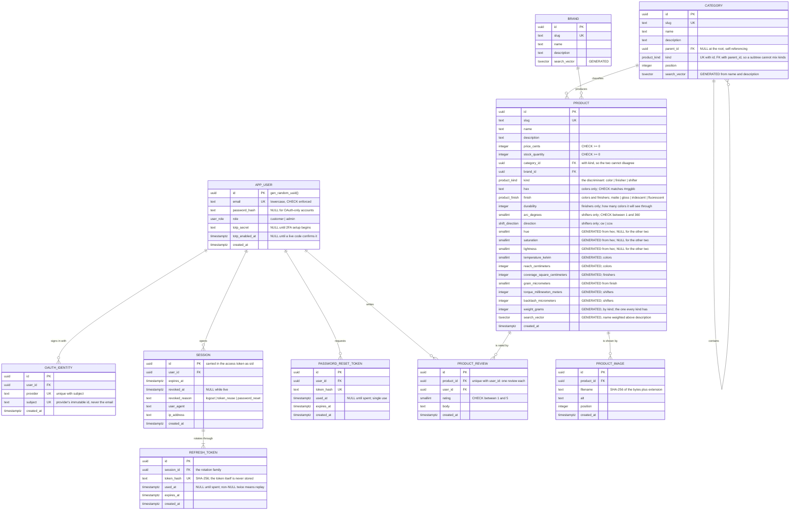

# Prism

**A business-to-consumer storefront that sells colors.** Not paint — colors. Each SKU is a
single hue, sold as itself: `Screaming Pumpkin`, `Municipal Beige`, `Void Black`. Brands
are pigment foundries.

There are three categories, and they have almost nothing in common:

| Category | What it is | What it carries |
| --- | --- | --- |
| **Colors** (240) | A color, sold whole | A hex and a finish |
| **Finishers** (32) | Puts a finish back on a color you own | The finish it applies, and a durability — how many colors it will see through |
| **Shifters** (24) | Turns a color you own into a different one | A direction round the wheel, and an arc in degrees |

The unusual product turns out to be a good fit for the requirements. A color has real
numeric attributes — hue angle, saturation, lightness — which makes faceted search
genuinely interesting rather than a brand checkbox, and it means the swatch images can be
generated at seed time instead of committed as binaries. A finisher and a shifter have no
image at all: the grid draws them from their own spec, so there is nothing on disk that
could disagree with the numbers beside it.

Three categories with disjoint attributes is the interesting modelling problem here, and it
is solved as a **tagged union in the table**: one `kind` discriminant, one column per
variant field, and a CHECK constraint that spells out the exact shape of each variant. A
shifter with a hex is rejected by the database rather than by a code path somebody has to
remember to write. Two composite foreign keys do the part a CHECK cannot, because a CHECK
may not look at another row — a category subtree cannot mix kinds, and a product cannot be
filed outside its own category. [`spec.ts`](apps/api/src/modules/catalog/spec.ts) is the
one place that turns those nullable columns back into a discriminated union, after which
nothing downstream sees a null.

The required weight and dimensions belong to the thing itself rather than to a container,
because there is no container — and what there is to measure follows from what the thing is:

| | Colors | Finishers | Shifters |
| --- | --- | --- | --- |
| | **Temperature** how warm it burns · °C / °F | **Coverage** how much surface it will see through · m² / ft² | **Torque** how hard it has to turn · N·m / lbf·ft |
| | **Reach** how far away it still reads · m / ft | **Grain** how much texture it leaves · µm / mil | **Backlash** the play before the color moves · mm / in |
| | **Weight** how heavy it looks · g / oz | **Weight** the tin and its contents · g / oz | **Weight** the gear itself · g / oz |

Weight is the one all three share, because the requirement names it and because everything
in the shop has some. A color has three independent facts, so it gets three independent
measurements; the other two have only two each, so their three are three different functions
of those two — which is the honest limit of what they carry.

Every one is a generated column, so `hex`, `finish`, `durability`, `arc_degrees` and
`direction` are the only stored facts about any product. Kelvin is what the temperature
column holds, being the unit the derivation is defined in, and nothing displays it: "6208 K"
describes a light source rather than a color.

Beneath the three categories is a nested taxonomy, presented as **tags**: singular (`gold`),
shown on every swatch, clickable, and typed straight into the search box in either number —
"gold" and "golds" both land on the same filter. Selecting one takes its whole subtree, so
`yellow` includes the golds and the acids. The category itself is never a tag; it is the
first filter in the rail, and it decides which controls the rest of the rail even offers.

This is **Project 1 (Foundation)**: accounts, the database, and the catalog. Carts,
checkout and orders are Project 2; the admin interface is Project 3.

---

## Running it

**Docker is the only prerequisite.** No Node, no Postgres, no accounts anywhere.

```bash
./start.sh
```

That builds the images, starts the stack, applies the migrations, seeds 296 products —
240 colors with their swatch images, 32 finishers and 24 shifters — and waits until the
storefront answers.

| Service | URL |
| --- | --- |
| Storefront | <http://localhost:3000> |
| API documentation | <http://localhost:3000/api/docs> |
| Inbox (Mailpit) | <http://localhost:8025> |

Two accounts are seeded, both with the password `colors are not paint`:

| Email | Role |
| --- | --- |
| `admin@prism.test` | admin |
| `shopper@prism.test` | customer |

```bash
./start.sh down     # stop
./start.sh reset    # stop and delete the volumes
```

### Why it needs no secrets

CAPTCHA and OAuth would normally need a Google Cloud account, which would make "Docker is
the only prerequisite" false. Both default to a mode that works offline:

- **CAPTCHA** renders the genuine reCAPTCHA widget using Google's published always-pass
  test key pair. The widget is real and the server-side check is real; the key is the one
  Google provides for exactly this situation.
- **OAuth** runs the full authorization-code flow — for both Google and GitHub — against a
  consent screen this API serves itself. The redirect, the `state` check, the code
  exchange, the profile lookup and the account linking are all real; only the identity
  provider is local. Each provider signs its own authorization codes, so a code minted for
  one is rejected by the other, exactly as two real providers behave.

Set real credentials in `.env` and the same code paths verify against the real thing:

```ini
CAPTCHA_MODE=google
RECAPTCHA_SITE_KEY=...
RECAPTCHA_SECRET_KEY=...

OAUTH_MODE=live
GOOGLE_CLIENT_ID=...
GOOGLE_CLIENT_SECRET=...
GITHUB_CLIENT_ID=...
GITHUB_CLIENT_SECRET=...
```

In `live` mode a provider is offered only when **both** halves of its credential pair are
set, so configuring GitHub alone is a valid setup — the sign-in page asks
`GET /auth/oauth/providers` and renders only the buttons that can actually work.

Authorized redirect URIs:

```text
http://localhost:3000/api/v1/auth/oauth/google/callback
http://localhost:3000/api/v1/auth/oauth/github/callback
```

Two-factor is enforced on **every** path. A provider proves who owns the third-party
account, not that the second factor this account asked for was satisfied — and since a
provider reporting a matching verified address links itself, that is not a bar the owner
controls. An OAuth sign-in into an account with TOTP lands on the same challenge page
password sign-in uses, with the token in an httpOnly cookie rather than the URL.

Password-reset email goes to the **Mailpit** container, a local inbox at
<http://localhost:8025> — not to a real address. Set `SMTP_HOST`, `SMTP_USER`,
`SMTP_PASSWORD` and `SMTP_SECURE` in `.env` to send through a real relay.

The GitHub app needs the `read:user` and `user:email` scopes. Without `user:email` the
emails endpoint returns 403 and any account with a private address cannot sign in at
all — GitHub's `/user` returns `email: null` for those, which is the default for many
accounts.

### Tests

```bash
npm test              # everything: 471 tests
npm run test:unit     # the fast ones only
npm run test:e2e      # 48 Playwright specs, against the running stack
npm run typecheck
```

The integration tests start a real Postgres via Testcontainers, so Docker must be running.
The end-to-end specs drive a real browser and expect `./start.sh` to have been run first.

---

## Entity relationship diagram

Cardinality is on the connector; modality is in the notes beneath.



**Modality.** Every foreign key above is mandatory except `category.parent_id`, which is
optional and marks one of the three category roots. A `session` need not have a
`revoked_at`; a `refresh_token` need not have a `used_at`; an `app_user` need not have a
`password_hash` (OAuth-only) or a `totp_secret` (2FA off). Each of those is mapped to an
`Option` at the repository boundary, so nothing above that layer sees a `null`.

`product`'s nullable columns are a different thing and are not optional data: they are the
arms of a sum type, and `product_variant_shape` requires exactly the right set of them to be
present for each `kind`. They become a discriminated union at the same boundary, so a
shifter has no `hex` field at all rather than a `hex` that is null.

```sql
CONSTRAINT product_variant_shape CHECK (
  CASE kind
    WHEN 'color'    THEN hex IS NOT NULL AND finish IS NOT NULL
                     AND durability IS NULL AND arc_degrees IS NULL AND direction IS NULL
    WHEN 'finisher' THEN hex IS NULL AND finish IS NOT NULL AND durability IS NOT NULL
                     AND arc_degrees IS NULL AND direction IS NULL
    WHEN 'shifter'  THEN hex IS NULL AND finish IS NULL AND durability IS NULL
                     AND arc_degrees IS NOT NULL AND direction IS NOT NULL
  END
)
```

Each branch names every variant column, including the ones it forbids, so adding a fourth
kind without deciding what it carries fails the insert rather than quietly admitting a row
with nothing in it.

**Cardinality.** A session has *at least one* refresh token (`||--|{`) — it is created
with its first one in the same transaction, because a session with no token is unusable.
Everything else is zero-or-more.

### One view, no stored aggregates

There is no `rating_avg` or `rating_count` column. A view owns the aggregation and every
catalog read goes through it:

```sql
CREATE VIEW product_listing AS
SELECT p.*, b.name AS brand_name, c.name AS category_name,
       COALESCE(AVG(r.rating), 0)::numeric(3,2) AS rating_average,
       COUNT(r.id)::integer                     AS rating_count
FROM product p
JOIN brand b ON b.id = p.brand_id
JOIN category c ON c.id = p.category_id
LEFT JOIN product_review r ON r.product_id = p.id
GROUP BY p.id, b.id, c.id;
```

A displayed rating therefore cannot disagree with the reviews it came from. If aggregation
ever costs too much, `CREATE MATERIALIZED VIEW` is the only word that changes — no
application code moves.

The same principle appears three times with three mechanisms:

| Derived value | Mechanism | Why that one |
| --- | --- | --- |
| Ratings | SQL view | Aggregates across rows; only the database can |
| Hue / saturation / lightness | `GENERATED ALWAYS … STORED` | Must be **indexable** for range faceting, so it has to be materialized — but Postgres owns the derivation, not the app |
| Temperature / reach / weight | `GENERATED ALWAYS … STORED` | Same reason, and it leaves the five variant columns as the only stored facts about any product |
| Imperial units | Pure TypeScript function | Presentation only; never filtered or sorted on |

Every measurement column but weight is generated straight from the facts of the kind it
belongs to, and those functions are `STRICT` — so a column goes null exactly when the facts
it is made of are absent, with no `CASE` needed to say so twice. Weight is the one every
kind has, so weight alone dispatches on `kind`, and it has no `ELSE`: the same trick as the
CHECK above, so a fourth kind produces a NULL in a `NOT NULL` column and the insert fails
rather than the shop quietly selling something with no measurements.

Each is stored in the smallest whole unit — centimetres, square centimetres,
millinewton-metres, micrometres — so the columns stay exact integers. Scaling to a readable
unit is presentation, and happens in `@prism/shared` alongside the imperial conversion.

---

## Architecture

A **modular monolith** with ports and adapters inside. One deployable API, split into
modules that own their tables. Projects 2 and 3 arrive as new modules, not a rewrite.

```text
apps/api/src/
  main.ts        process entry: config, database, listen, graceful shutdown
  app.ts         the composition root — the only file that knows which
                 adapter implements which port
  config.ts      environment parsed once by Zod; a bad container dies at boot
  platform/      ports and their adapters
                 clock · hasher · tokens · mailer · captcha · oauth · storage · cache
  http/          errors · cookies · guard
  modules/
    auth/        routes | service | repository | emails | mock-consent
    catalog/     routes | service | repository | search
  db/            schema · migrate · seed · palette · swatch

packages/shared/ Option · Result · units · color · errors · Zod contracts
apps/web/        React SPA
```

Services never import a concrete adapter. They receive `{ clock, hasher, tokens, repo }` as
an argument, which is what lets the tests run the real logic against a fake clock and an
in-memory mailer — and what will let Project 2 reuse `createAuthService` untouched.

### The stack

| Layer | Choice |
| --- | --- |
| Runtime | Node 26 — runs TypeScript directly via native type stripping, so the API has **no build step** |
| Language | TypeScript 7 (the native compiler), `strict` plus `noUncheckedIndexedAccess` and `exactOptionalPropertyTypes` |
| HTTP | Fastify 5 with `fastify-type-provider-zod` |
| Database | PostgreSQL 18, Drizzle ORM 0.45, hand-written SQL migrations |
| Errors | `neverthrow` `Result<T, DomainError>` — no `throw` in domain code |
| Matching | `ts-pattern`, including all JSX conditionals |
| Frontend | React 19, Vite 8, Tailwind 4, React Router 8 (data mode), TanStack Query |
| Web server | Caddy |
| Tests | Vitest 4, `fastify.inject`, Testcontainers |

### Types carry the rules

`packages/shared` defines the vocabulary the whole codebase speaks:

```ts
type Option<A> = { _tag: "Some"; value: A } | { _tag: "None" }

type DomainError =
  | { _tag: "InvalidCredentials" }
  | { _tag: "RefreshTokenReused" }
  | { _tag: "ValidationFailed"; issues: readonly ValidationIssue[] }
  | …
```

The repository layer is the only place that sees a nullable column. Every service returns
`Result<T, DomainError>`, and the HTTP layer maps the error tag to a status code through a
`Record<DomainErrorTag, number>` — a record keyed by the tag union is exhaustive by
construction, so **adding an error variant is a compile error until every layer handles
it**.

There are no `as` casts anywhere in the codebase. `unknown` appears only in type
predicates at genuine parse boundaries — JWT payloads, Fastify's error handler, OAuth
provider responses, and the `grecaptcha` global — where the value really is unknown until
checked.

---

## The four explainers

### JWT, and its three parts

A JSON Web Token is three base64url segments separated by dots.

**Header** — the algorithm and type: `{"alg":"HS256","typ":"JWT"}`.

**Payload** — the claims. Ours carries the registered claims `iss`, `aud`, `iat`, `nbf`,
`exp`, `sub`, `jti`, plus `sid` (the session) and `role`:

```json
{
  "sub": "8f2c…", "sid": "b41e…", "role": "customer", "jti": "c7a9…",
  "iss": "prism", "aud": "access",
  "iat": 1786116800, "nbf": 1786116800, "exp": 1786117700
}
```

**Signature** — `HMAC-SHA256(base64url(header) + "." + base64url(payload), secret)`.

The critical property is that a JWT is **signed, not encrypted**. Anyone holding one can
read the payload; the signature only proves it has not been altered. That is why the
payload holds an opaque user id and nothing else — no email, no password hash, nothing
worth reading. A unit test asserts the exact key set, so a future field cannot slip in
unnoticed.

Verification pins the algorithm to `HS256`. Without that, a token claiming `alg: none`
would be accepted as valid with no signature at all — the classic JWT bypass. There is a
test for it.

`aud` separates token kinds. The 2FA challenge token is signed with the same key, so
without an audience check it would be usable as an access token. Both directions are
tested.

### ACID, and where each property earns its place

**Atomicity** — a session and its first refresh token are inserted in one transaction. A
session with no token cannot be used; a token with no session cannot be verified. Either
both exist or neither does.

**Consistency** — the schema refuses invalid states rather than trusting the application:
`hex ~ '^#[0-9a-f]{6}$'`, `rating BETWEEN 1 AND 5`, `price_cents >= 0`,
`email = lower(email)`, and `totp_enabled_at IS NULL OR totp_secret IS NOT NULL` — 2FA
cannot be switched on without a secret to check codes against. Generated columns cannot be
written at all; the integration suite asserts that an `UPDATE product SET hue = 999` is
rejected.

**Isolation** — this one is worth the detail, because the obvious answer is wrong.

Refresh rotation must be single-use: presenting a spent token means somebody holds a copy,
and the whole session should die. The transaction takes `SELECT … FOR UPDATE` on the token
row, marks it used, and inserts its successor.

The instinct is to run it `SERIALIZABLE`. **That breaks the requirement.** Under
`SERIALIZABLE`, the second of two concurrent refreshes cannot see the row version the first
one just committed, so it aborts with a serialization failure — turning a detectable replay
into a retryable error and losing the revocation entirely.

Under the default `READ COMMITTED`, the blocked transaction re-reads the row after the lock
is released, observes `used_at` already set, and deterministically detects the replay. The
row lock already provides the ordering; the *weaker* isolation level is what lets the second
request see what the first one did. Picking the strongest-sounding level would have defeated
the mechanism it was meant to protect.

**Durability** — Postgres commits to the WAL before acknowledging, and the data directory
is a named Docker volume, so a `docker compose down` and back up finds every account and
order intact. Only `./start.sh reset` removes it.

### Postgres, and how it scales from here

*Reads* scale first and cheapest: streaming replicas take the catalog traffic, which is
almost all of it, while writes stay on the primary. The application is already ready for
this — every catalog read goes through one view and one repository, so a read/write split
is a connection-string change in `platform/`, not a refactor.

*Connections* are the usual first wall, since each Postgres backend is a process. PgBouncer
in transaction mode fronts it; the pool size is already configuration
(`DATABASE_POOL_SIZE`).

*Indexes* carry the current query shapes: GIN on three `tsvector` columns for search, GIN
`gin_trgm_ops` for typeahead, B-tree on `price_cents`, `hue` and `saturation` for range
facets, and a partial index `WHERE revoked_at IS NULL` for the session guard's hot path,
which runs on every authenticated request.

*Caching* is two layers. An in-process TTL cache holds the category tree, facet counts and
product detail; `Cache-Control` and `ETag` let Caddy and the browser stop asking. A single
API container makes an in-process cache strictly better than Redis — same semantics, no
network hop, no extra service. It stops being correct at two containers, which is what the
`Cache<A>` port is for: a Redis adapter is a new file behind the same interface.

*Partitioning* is the far end, and only for tables that grow without bound —
`product_review` and, in Project 2, `order`. Both are naturally range-partitioned by
`created_at`.

The catalog itself does not grow the way order history does, which is why none of this is
built yet. Building it now would be guessing at a shape the traffic has not taken.

### Testing

**471 tests**, in three layers with deliberately different costs, plus 48 in a real browser.

*Unit* (321) — pure functions and injected fakes, no I/O, ~1 second. `Option` combinators
and their laws; metric↔imperial conversion; WCAG luminance and contrast; every Zod schema
across valid, invalid and boundary input; JWT generation, validation and expiration against
a controllable clock; the TTL cache's expiry and eviction order; image type detection
against disguised payloads; the search and facet SQL builders, asserting on generated SQL
and bound parameters; the PNG encoder; the seeded PRNG and `hslToHex`; and the seam where
the product table's nullable columns become a discriminated union, including every shape
the variant constraint forbids.

*API integration* (122) — the real application over a real Postgres from Testcontainers,
driven through `fastify.inject` so routing, schema validation, guards and serialization all
run. Assertions read rows back rather than trusting the response: that the password was
hashed, that the refresh token is stored only as a digest, that a replay set
`revoked_reason = 'token_reuse'`.

*Security* (28) — SQL injection through every filter, sort and auth field; XSS payloads
stored and read back; JWT tampering (wrong key, `alg: none`, edited payload, wrong issuer,
invented session); mass assignment of `role`; path traversal through the media route;
oversized, malformed, wrongly-typed and deeply-nested bodies; rate limiting.

Note the asymmetry in the injection tests. Slug-shaped parameters are *rejected* — they
have a known shape, so anything else is malformed. The free-text search term is *accepted*
and returns zero results, because it is genuinely free text and the protection is
parameterisation rather than a blocklist. A blocklist that rejected `O'Brien's Red` would
be a worse product and no safer.

*End-to-end* (48) — Playwright against the running stack, for the things that only exist in
a browser: that the filter rail does not reflow, that dragging the hue ring works, that the
rail offers each category only the controls that category has, and that the auth routes send
you where they should — including that signing in lands on the catalog rather than the
account page, which depends on a redirect and a form navigation resolving in the same tick.

The signed-in specs share one browser context on purpose, and the comment saying so is
worth reading: handing a saved refresh cookie to several parallel contexts is a replay, and
replay detection revokes the session — the suite tripping over its own security is not a
result worth having.

**Manual tests**, run before each review because they involve a human or a third party:
the CAPTCHA renders and gates registration; Google and GitHub OAuth complete against real
credentials with `OAUTH_MODE=live`, including a GitHub account whose email is set to
private; and 2FA enrolment is scanned with a real authenticator app, the QR read from a
phone rather than a fixture.

Writing these found four real bugs the type system could not: a cache key that collided
when a search term contained `&`, a null byte in a search term producing a 500, Drizzle
wrapping Postgres errors so every duplicate email reported a generic conflict, and
`X-Frame-Options` defaulting to `SAMEORIGIN`.

---

## The API

Everything is under `/api/v1`. OpenAPI 3.1 is generated from the same Zod schemas that
validate the requests and is browsable at `/api/docs`.

### Auth

| Endpoint | Purpose |
| --- | --- |
| `POST /auth/register` | Email, password, CAPTCHA |
| `POST /auth/login` | Answers `authenticated` or `two_factor_required` |
| `POST /auth/login/2fa` | Completes a challenge |
| `POST /auth/refresh` | Rotates the refresh cookie, single-use |
| `POST /auth/logout` | Revokes the session |
| `GET  /auth/me` | The signed-in user |
| `POST /auth/password/forgot` | Always 204 |
| `POST /auth/password/reset` | Single-use token; ends every session |
| `POST /auth/2fa/setup` · `/enable` · `/disable` | TOTP enrolment |
| `GET  /auth/oauth/providers` | Which third-party sign-ins are live |
| `GET  /auth/oauth/:provider` + callback | Authorization-code flow (`google`, `github`) |

### Catalog

| Endpoint | Purpose |
| --- | --- |
| `GET /categories` | Tree with per-subtree product counts |
| `GET /products` | Search, filter, sort, page — with facet counts |
| `GET /products/suggest` | Typeahead |
| `GET /products/:slug` | One product, with its variant spec and both unit systems |
| `POST /admin/products/:slug/images` | Upload, admin only |
| `GET /media/:filename` | Serve a swatch |

```text
GET /api/v1/products
  ?q=screaming            full-text across product and brand, plus a substring
                          match on the color's own name — so "red" also finds
                          "Powdered". A category hit takes its whole subtree,
                          so "yellows" finds the golds filed beneath it

  &category=color         one of color | finisher | shifter, and the only
                          filter that decides which of the rest apply
  &tag=crimson            a node of the taxonomy; includes everything beneath it
  &brands=cyan-and-sons   comma-separated, multi-select
  &priceMin=1000&priceMax=5000
  &minRating=4

  colors only:
  &finishes=gloss,matte
  &hueMin=340&hueMax=20   an arc through 0° — where the reds live
  &saturationMin=60&saturationMax=100
  &lightnessMin=0&lightnessMax=40

  finishers only:
  &finishes=gloss         the finish it applies; the rail offers one at a time

  shifters only:
  &arcMin=90&arcMax=270   how far round it turns a color
  &direction=cw|ccw

  &sort=relevance|price_asc|price_desc|rating
  &page=1&perPage=12
```

Facet counts are computed against every filter *except* the dimension being counted, so
ticking a second brand widens the result rather than emptying it. The category dimension
drops more than its own filter: it drops every filter only one kind can satisfy. Counting
how many *colors* satisfy an arc would answer zero, for a reason that has nothing to do
with the question — so those filters leave with the category that owns them, which is also
what the rail does when you switch.

---

## How the security requirements are met

**Access tokens live in memory.** A module-level variable in the SPA — never
`localStorage`, never `sessionStorage`, never a cookie. There is nothing for an injected
script to read and nothing that survives the tab closing. What survives a reload is the
httpOnly refresh cookie, which script cannot touch either; the app trades it for a fresh
access token on boot.

**Refresh rotation is single-use with replay detection.** Every refresh issues a new token
and marks the old one spent. Presenting a spent token revokes the entire session — not just
that token — because a token presented twice means somebody has a copy. The integration
suite proves the legitimate holder is locked out too, which is the point: the account owner
is meant to notice.

**Both token types are revocable.** The access token carries its session id as `sid`, and
the guard checks that session is still live on every request. Logging out kills a valid,
unexpired JWT *immediately* rather than within fifteen minutes. That is one indexed
primary-key lookup per request, and it is the honest price of revocable stateless tokens.

**Tokens are stored as digests.** Refresh and reset tokens are opaque 256-bit random
strings; only their SHA-256 is stored. A database leak yields digests, not credentials.

**Sign-in does not leak account existence.** A wrong password and an unknown address return
byte-identical responses, and an unknown address still performs a real argon2 verification
against a decoy hash so the timing matches. Password reset always answers 204.

**Passwords are argon2id** at the OWASP minimum (19 MiB, 2 iterations). The policy follows
NIST SP 800-63B: a 12-character minimum and a denylist, no composition rules — those mostly
teach people to write `Password1!`.

**Uploads are identified by content.** The file type comes from magic bytes, not the
filename or the declared `Content-Type`, and the stored filename is the SHA-256 of the
bytes — so nothing an uploader controls ever reaches the filesystem.

**Validation runs on both sides from one definition.** The Zod schemas in
`packages/shared` are simultaneously the server validator, the OpenAPI spec, and the
client-side form rules. There is one place to change a rule and no way for the two sides to
drift.

---

## What is deliberately not here

Cart, checkout, payments and orders are Project 2. The admin *interface* is Project 3 —
though `role` exists from the first migration and the admin API is role-gated already, so
Project 3 adds screens rather than schema.

The storefront is functional rather than polished, which is the correct scope for Project 1;
Project 3 is where the interface requirement lands. It is responsive, keyboard-navigable,
and honours `prefers-reduced-motion` and `prefers-color-scheme`, with a light/dark toggle
that overrides the system preference — blue accents in daylight, yellow after dark, and
near-neutral chrome throughout so that the only vivid things on the page are the products.
