# Prism

A small business-to-consumer shop. Shoppers browse a home page of featured products, search a
catalog with filters that forgives typos, keep a cart as guests or members, check out on one
page with card payments through Stripe's test mode, follow and cancel their orders, and review
what was delivered to them with stars, text and helpful votes. Staff run the shop from an admin
area: products and bulk import, categories and brands, orders, delivery options and refunds,
review moderation, accounts and roles, and an audit log. Every staff account signs in with
two-factor authentication.

The code does not know what the shop sells. Every filter comes from the products' own
properties at query time, so the same code sells lamps, books or pet food.

Fastify API on Node, Postgres behind Drizzle, RabbitMQ between the order and payment services,
React storefront built with Vite and served over HTTPS by Caddy. TypeScript end to end. Docker
is the only thing a machine needs; taking test payments also needs a free Stripe account's test
keys.

## Running it

```sh
./start.sh        # Linux and macOS
.\start.cmd       # Windows, from cmd or PowerShell
```

| Command | What it does |
| --- | --- |
| `./start.sh` | Copies `.env.example` to `.env` if there is none, then builds, migrates and starts everything, and seeds the shop. |
| `./start.sh --pull` | The same, and refreshes the base images. |
| `./start.sh down` | Stops the stack. |
| `./start.sh reset` | Stops it and deletes the database, the media and the certificate. |
| `./start.sh seed` | Runs only the seed: placeholder products, reviews and a demo shopper, planted into an empty catalog. |
| `./start.sh test` | Runs every test suite in a container. |
| `./start.sh test npm run test:unit` | Runs only the unit tests there. |
| `./start.sh test e2e` | Runs the browser suite against a stack of its own, `prism-e2e`, and removes that stack afterwards. |
| `./start.sh loadtest baseline` | Runs one load test, `baseline`, `normal`, `peak` or `stress`, against a stack of its own, `prism-load`. See [Performance](#performance). |
| `./start.sh loadtest down` | Removes the load test's stack. |

On Windows each command is `.\start.cmd ...` with the same arguments.

| What | Where |
| --- | --- |
| Storefront | <https://localhost:3000> |
| Admin | <https://localhost:3000/admin> |
| API | <https://localhost:3000/api/v1> |
| Inbox for the shop's mail (Mailpit), as `prism` / `MAILPIT_PASSWORD` | <http://localhost:8025> |
| RabbitMQ management UI, as `prism` / `RABBITMQ_PASSWORD` | <http://localhost:15672> |

Both passwords are `prism` unless `.env` sets them.

The storefront answers HTTPS only, with a self-signed certificate that the web container makes
on its first start. The browser warns about it once: accept the warning to go on. The
certificate lasts 825 days and stays in a volume, so the browser's exception keeps working
until `./start.sh reset`. Links in mail and the provider sign-ins are built from
`PUBLIC_WEB_URL`, which is `https://localhost:3000`; `./start.sh` says so when `.env` holds an
`http://` address.

| Account | Sign-in |
| --- | --- |
| Demo shopper | `shopper@prism.test` / `correct horse battery staple` |
| Admin | `ADMIN_EMAIL` / `ADMIN_PASSWORD` from `.env`, and a code from `ADMIN_TOTP_SECRET` |

The API makes the admin at start when no account holds the admin role, with 2FA already on.
`.env.example` sets `admin@prism.shop`, `admin-prism-admin` and the key
`CFBNJ5LGD7BVFZHEQTQTFJR5CQCI6KYS`. Type the key into an authenticator app, where it is often
called a setup key, then sign in with the password and the app's code. Once an admin exists,
the three values change nothing.

The stack runs with no external accounts: the CAPTCHA uses Google's always-pass test key, the
provider buttons go to a built-in stand-in, and mail lands in Mailpit. Real keys go in `.env`;
`.env.example` describes each one. Its `JWT_SECRET`, `DATA_ENCRYPTION_KEY` and admin values are
public, so replace them anywhere but your own machine.

### Taking test payments

Without Stripe keys the cart works and checkout says that payments are not set up. To pay:

1. Sign up at <https://dashboard.stripe.com>, which is free, and stay in test mode.
2. Copy the two test keys from Developers > API keys into `.env`: `STRIPE_SECRET_KEY`
   (`sk_test_...`) and `STRIPE_PUBLISHABLE_KEY` (`pk_test_...`).
3. Run `./start.sh` again.

Stripe tells the shop how each payment went through a webhook. `COMPOSE_PROFILES=stripe` in
`.env` starts the Stripe CLI as a container that forwards those webhooks to the API, so the
laptop needs no public address and no CLI of its own. To run the CLI on the host instead,
remove that line, run
`stripe listen --forward-to localhost:3000/api/v1/payments/webhook`, and put the `whsec_...`
secret it prints into `STRIPE_WEBHOOK_SECRET`.

`PAYMENTS_MODE=simulated` in `.env` takes payments without Stripe, on `localhost` only: checkout
asks for no card, and every payment succeeds at once. The browser suite and the load test run
this way.

The seed is separate from the shop: the shop runs without it, and a failed seed leaves an
empty shop. Its data is one archive, `apps/api/seed/data.zip`. It plants reviews and helpful
votes too, and gives the demo shopper three delivered orders, whose products are ready to
review, and one shipped order. `apps/api/seed/README.md` has the details.

### Running it without the scripts

1. Copy `.env.example` to `.env`.
2. `docker compose up --build --detach`. If it fails, `docker compose logs migrate` says why.
3. Open <https://localhost:3000> and accept the certificate warning. The storefront answers a
   few seconds after step 2 returns.
4. `docker compose down` stops the stack. Add `--volumes` to delete the data too.

Placeholder products: `docker compose run --rm --build seed`.

Tests: `docker compose run --rm --build test`. Append `npm run test:unit` for the unit tests
only.

### Working on it without the containers

Only development needs Node.

```sh
npm ci && npm run build                         # the shared package both apps import
npm run dev --workspace @prism/web              # storefront with hot reload, proxied to the running stack
npm run typecheck
npm run test:unit                               # unit tests of every workspace
npm test --workspace @prism/api                 # unit, integration, security and flows; Docker running
```

The browser suite runs against the `prism-e2e` stack, whose admin it knows:

```sh
COMPOSE_PROFILES= docker compose -p prism-e2e -f docker-compose.yml -f docker-compose.e2e.yml up --build --detach
COMPOSE_PROFILES= docker compose -p prism-e2e -f docker-compose.yml -f docker-compose.e2e.yml run --rm --build seed
cd apps/e2e && npx playwright install chromium
E2E_BASE_URL=https://localhost:3200 npm run e2e
```

## Usage

### Shopping

- **Home** (`/`): featured products, a tile per category, "Top rated", "New arrivals", and the
  products this browser viewed last.
- **The listing**: the whole shop (`/shop`), one category (`/categories/<slug>`) and search
  results (`/search?q=`) share one page: the result count, the filters, the sort, the pages,
  and a grid or a list. The view, the filters and the page live in the URL, so a view is a
  link.
- **Quick search** sits in the header of every page. From two letters it suggests products with
  their picture and price, and "Search for ..." last. The arrow keys move, Enter opens and
  Escape closes. `/` jumps to the box from anywhere.
- **Typos**: when nothing matches exactly, the results show similar names under 'No exact
  matches for "...". Showing similar names.'
- **Filters**: brands, a price range, a minimum rating, and one group per property of the
  matching products, each value with its count. A value the other filters leave nothing for
  is grayed out, not removed. A narrow screen puts the filters in a drawer.
- **Active filters** sit beside the count, each with a cross. "Clear all filters" keeps the
  search text and the category.
- **Sort**: relevance, price either way, rating, or newest.
- **Product page**: pictures in a gallery with a full-size view, price, stock, brand, category,
  the rating summary, description, properties, and weight and size in metric or imperial
  units. A quantity and "Add to cart", or "Sold out" when there is no stock. Below them, the
  reviews and related products from the same category.

### Reviews

- A product shows the average of its approved reviews, how many there are, and how many gave
  each number of stars.
- Reviews sort by "Most helpful", which is the default, "Newest", "Highest rating" or "Lowest
  rating".
- **Helpful**: a signed-in shopper marks a review helpful once, and can take it back. Nobody
  votes for their own review.
- **Writing a review** takes a signed-in customer with a delivered order of the product: 1 to 5
  stars, a byline, and an optional title and text. Its author sees it as "Waiting for approval"
  until a moderator approves it; a rejected one shows the moderator's reason. Editing an
  approved review sends it back for approval. One review per product per person.
- The mail that says an order arrived links to the review form of each product in it.

### Cart

- The cart button in the header shows how many items the cart holds, at every width. It opens
  a **quick preview** with the lines, the subtotal, how far the cart is from free shipping,
  and links to the cart and to checkout. Adding a product opens it too.
- **Cart page**: each line with its picture, name, unit price, a quantity stepper, a remove
  button and the line total. The subtotal changes as soon as a quantity does.
- Asking for more than the stock says how many are left. A line the shop can no longer supply
  in full says so, with a button that reduces it to what is left.
- **Recommended for you**: in-stock products from the same categories as the cart, best rated
  first.
- **Guests** keep their cart for 30 days in the browser that made it. **Members** keep theirs
  in the account, across devices and sign-ins. Signing in moves a guest's cart into the
  account's.

### Checkout

One page, in five parts, with the order summary beside it, or folded at the top on a narrow
screen. The summary has steppers and remove buttons too.

1. **Contact**: name, email, phone.
2. **Shipping address**. Once it is complete, the page looks it up in OpenStreetMap and says
   "Address found", or that it could not find it.
3. **Billing address**: "Same as the shipping address" is checked until you uncheck it.
4. **Delivery**: the delivery options staff set, each with its price and the dates it should
   arrive between.
5. **Payment**: Stripe's card fields.

A signed-in customer starts with the name and phone of their profile, their default saved
address and the delivery option of their last order; whatever the profile and the saved
addresses lack comes from the last order. They can pick another saved address, and save the
one they typed. A guest gets a "Sign in for faster checkout" link. "Place order" checks every field and the card
before anything is sent, places the order, then has Stripe confirm the payment. The order page
that follows is the confirmation: the order number, the payment reference, the expected
delivery dates and the summary. It updates by itself once the payment settles, and the
confirmation mail arrives in Mailpit.

Stripe's test cards, with any future expiry and any CVC:

| Card | What happens |
| --- | --- |
| `4242 4242 4242 4242` | Paid |
| `4000 0000 0000 9995` | Declined: insufficient funds |
| `4000 0000 0000 0069` | Declined: expired card |
| `4000 0000 0000 0127` | Declined: incorrect CVC |
| `4000 0000 0000 3220` | Asks for 3D Secure; approve or fail it |
| `4242 4242 4242 4241` | Refused by the card field before submission: invalid number |

A declined order releases its stock and mails the reason; the cart keeps its items, so
"Place order" again tries another card. To see a gateway timeout, set `STRIPE_TIMEOUT_MS=1` in
`.env`, run `docker compose up -d api`, and place an order.

### Orders

- **Orders** (`/account/orders`, signed in): status chips, any number at once, a date range whose ends both
  count, and newest, oldest or status order. The filters live in the URL.
- **Order page**: status, a timeline of every change, the tracking number once shipped, the
  items, totals, delivery option and expected dates, the addresses, and how it was paid. A
  guest opens it from the link in the confirmation mail.
- **Cancel** works until the order is processing. A paid order is refunded in full, which
  shows in the timeline and arrives as a second mail.
- Staff move a paid order to processing, then shipped with a tracking number, then delivered.
  The customer gets a mail when it ships and when it arrives. An order unpaid for 30 minutes
  is canceled and its stock released.

### Accounts

- **Register**: email address, a password of at least twelve characters, and the CAPTCHA.
- **Sign in** with the password or a provider button. With no provider keys the button opens
  a stand-in consent page, where any address works. A page that asks you to sign in sends you
  back to it afterwards.
- **Password reset**: "Forgot your password?" mails a link to the Mailpit inbox. Setting the
  new password signs every session out.
- **The account** has three tabs of one width: Profile, Addresses and Orders.
- **Profile** (`/account`): full name and phone, which checkout fills in. The email is shown
  but stays as it is. The password and 2FA live here too.
- **Addresses** (`/account/addresses`): up to 10 saved addresses. One is the default, which
  checkout starts with.
- **Two-factor authentication**: on the account page, scan the QR code with an
  authenticator app and confirm a code. Sign-in then asks for a code, and so does turning
  it off. Each code works once. Staff cannot turn it off.
- **Sign out** revokes the session. The account menu holds Orders, Account, Admin for staff,
  and Sign out.

### Contact and the other pages

- **Contact** (`/contact`): name, email, topic, an optional order number, the message and the
  CAPTCHA. The support inbox, `SUPPORT_EMAIL`, gets the message with Reply-To set to the
  sender, and the sender gets a copy. Both land in Mailpit. Nothing is stored.
- **About**, **FAQ**, **Terms** and **Privacy**, linked from the footer.
- An address the shop does not know shows a page with a search box and a link home, and
  answers with status 404.

### Admin

Open <https://localhost:3000/admin>, or "Admin" in the account menu. Every account is a
customer; staff roles add what each job needs, and one account can hold several.

| Role | Can |
| --- | --- |
| Moderator | Approve, reject and delete reviews |
| Content manager | Products and their pictures, categories, brands, bulk import, and which products the home page features |
| Delivery manager | Move paid orders through processing, shipped and delivered; set the delivery options |
| Support | Find accounts and orders; cancel orders that have not shipped; refund |
| Admin | All of the above, plus staff roles, disabling accounts, resetting 2FA, signing accounts out, and the audit log |

A staff account needs 2FA. The admin sends a staff member without it to the account page to
set it up, and asks every session for a code before it opens, and again after 8 hours. The navigation shows
only the sections the account's roles allow, and every delete, cancellation and refund asks
first.

- **Dashboard**: counts that link to their lists, for the roles that act on them: orders to
  fulfill, paid today, reviews waiting, and products with 5 or fewer in stock.
- **Orders**: filter by status, dates, order number or customer email. An order's page moves
  it to its next status, cancels it, or refunds it in full.
- **Products**: create, edit and delete; pictures with their alt text, which is required, and
  their order; and whether the home page features the product.
- **Categories** and **Brands**: create, edit and delete. One that a product uses cannot be
  deleted.
- **Import**: one JSON or CSV file of up to 2 MB and 5,000 rows. "Check the file" shows the
  report, every problem by row and column, without writing anything; "Import" writes every
  row or none. A row updates the product with its slug, or creates one. Categories and brands are
  named by slug and must exist.

  ```csv
  slug,name,description,price,stock,category,brand,weight_g,width_mm,height_mm,depth_mm,featured,property:type
  golden-carrot-crate,Golden Carrot Crate,A crate of twelve golden carrots for long trips.,14.90,40,minecraft,mojang,900,300,200,200,false,Food
  lucky-chip,Lucky Chip,A poker chip that brings a little luck to every hand.,3.50,120,balatro,localthunk,10,40,40,3,true,Collectible
  ```

  `price` is in euros with at most two decimals, and each `property:<name>` column is one
  property, empty for none. A JSON file is an array of objects with the fields `slug`, `name`,
  `description`, `priceCents`, `stock`, `category`, `brand`, `weightGrams`, `widthMm`,
  `heightMm`, `depthMm`, `featured` and `properties` (`[{ "name", "value" }]`).
- **Reviews**: the queue of reviews waiting; approve, reject with a reason, or delete.
- **Delivery options**: name, price, the amount from which it ships free, the delivery window
  in business days, whether checkout offers it, and its place in the list. An option that
  orders used can be switched off, not deleted. Placed orders keep their own copy.
- **Accounts**: find one by exact email or by role, with its orders and reviews; give and take
  staff roles; disable and enable it; reset its 2FA; sign it out. Nobody changes their own
  roles or disables themselves, and the last admin keeps the role.
- **Audit log**: every staff change, filtered by who, what, which record and when.

### The API

Every route is under `/api/v1` and answers JSON. A refusal is
`{ "error": { "code", "message", "issues" } }`, where `issues` names the rejected fields, or
the products a stock refusal is about. Authenticated routes take
`Authorization: Bearer <access token>`; cart and order routes take it when there is one.
Every answer from a limited route carries `RateLimit-Remaining`; a refusal for going too fast
is `429` with `Retry-After`.

| Method and path | What it does |
| --- | --- |
| `POST /auth/register` | Opens an account. Body: `email`, `password`, `captchaToken`. |
| `POST /auth/login` | Signs in. Answers a grant, or a challenge when 2FA is on. |
| `POST /auth/login/2fa` | Finishes a challenged sign-in with a code. |
| `POST /auth/refresh` | Trades the refresh cookie for a new access token and cookie. |
| `POST /auth/logout` | Revokes the session. |
| `GET /auth/me` | The signed-in user, with their staff roles and whether the session passed a code check. |
| `POST /auth/password/forgot` | Sends a reset link. Answers the same whether the address exists. |
| `POST /auth/password/reset` | Sets a password against a token from the mail. |
| `POST /auth/password` | Changes, or sets, the password of the signed-in user. |
| `POST /auth/2fa/setup` | Starts enrollment: an `otpauth://` URI and a QR code. |
| `POST /auth/2fa/enable` | Confirms enrollment with a live code. |
| `POST /auth/2fa/verify` | Confirms the session with a live code, as the admin asks. |
| `POST /auth/2fa/disable` | Turns 2FA off with a live code. Refused for staff. |
| `GET /auth/oauth/providers` | Which provider buttons to show. |
| `GET /auth/oauth/:provider` | Starts a provider sign-in. |
| `GET /auth/oauth/:provider/callback` | Where the provider returns. |
| `GET` and `POST /auth/oauth/:provider/consent` | The stand-in's consent page, for a provider without keys. |
| `GET /home` | Featured, top-rated and newest products, and the categories. |
| `GET /categories` | Every category with its description, product count and a picture. |
| `GET /products` | Searches the catalog. See the query keys below. |
| `GET /products/suggest?q=` | Names containing the typed text, those starting with it first, with a thumbnail and the price. |
| `GET /products/:slug` | One product with its measurements in both unit systems. |
| `GET /products/:slug/related` | Up to 8 products from the same category. |
| `GET /products/:slug/reviews` | Approved reviews with the average and the distribution. Reads `sort` (`helpful`, `newest`, `highest`, `lowest`) and `page`. |
| `GET /products/:slug/reviews/viewer` | Whether the signed-in reader may review, their own review, and the reviews they found helpful. |
| `PUT /products/:slug/reviews/mine` | Writes or edits the reader's review, which then waits for approval. |
| `DELETE /products/:slug/reviews/mine` | Deletes it. |
| `PUT /reviews/:id/vote` | Marks a review helpful. `DELETE` takes it back. |
| `GET /cart` | The caller's cart. A guest's is found by the `prism_cart` cookie. |
| `POST /cart/items` | Adds `quantity` of `productId`. Starts a guest cart and sets its cookie when needed. |
| `PUT /cart/items/:productId` | Sets the quantity of a line. |
| `DELETE /cart/items/:productId` | Removes a line. |
| `GET /cart/recommendations` | Products to go with the cart. |
| `GET /shipping-methods` | The delivery options checkout offers. |
| `GET /checkout/config` | Whether payments are on, and how: Stripe with its publishable key, or simulated. |
| `GET /checkout/prefill` | The signed-in customer's details for the form. |
| `POST /checkout/address` | Looks an address up: `verified`, `not_found` or `unavailable`. |
| `POST /orders` | Places an order from the caller's cart. Body: `contact`, `address`, `shippingMethod`, `expectedTotalCents`, and optionally `billingAddress` and `shouldSaveAddress`. Answers the order and what the browser confirms the payment with; a guest also gets the order's key. |
| `GET /orders` | The signed-in customer's orders. Reads `status` (repeats), `from`, `to`, `sort` (`newest`, `oldest`, `status`), `page`, `perPage`. |
| `GET /orders/:id` | One order. A guest adds `?key=`. |
| `POST /orders/:id/cancel` | Cancels an order not yet processing, and refunds it if paid. |
| `GET /account/profile` | The signed-in customer's name and phone. `PUT` changes them. |
| `GET /account/addresses` | Their saved addresses. `POST` saves one more. |
| `PUT /account/addresses/:id` | Changes one; `isDefault: true` makes it the default. `DELETE` deletes it. |
| `POST /support/messages` | Sends the contact form. Body: `name`, `email`, `topic`, `orderNumber`, `message`, `captchaToken`. |
| `GET /seo/robots.txt`, `GET /seo/sitemap.xml` | The crawler files, which the web server serves at `/robots.txt` and `/sitemap.xml`. |
| `POST /payments/webhook` | Where Stripe reports payments and refunds. Checks Stripe's signature. |
| `GET /health` | Liveness. |

`GET /products` reads `q`, `category`, `brand`, `priceMin` and `priceMax` in cents, `rating`
as a minimum, `sort` (`relevance`, `price_asc`, `price_desc`, `rating`, `newest`), `page`,
`perPage`, and `p.<name>=<value>` for any property. `brand` and `p.<name>` repeat: values under
one key are alternatives, and different keys all have to hold. The answer carries the page of
items, the total, the facets, and `matched`: `exact`, or `similar` when it fell back to similar
names.

Staff routes are under `/api/v1/admin`. Each needs an account whose roles grant the
permission, with 2FA on, and a session that passed a code check within 8 hours.

| Method and path | Permission | What it does |
| --- | --- | --- |
| `GET /summary` | any staff role | The dashboard's counts that the roles cover. |
| `GET /orders`, `GET /orders/:id` | `orders.view` | Every order, by status, dates, number or customer email. |
| `POST /orders/:id/status` | `orders.fulfill` | Moves a paid order to `processing`, `shipped` (with `trackingNumber`) or `delivered`. |
| `POST /orders/:id/cancel`, `POST /orders/:id/refund` | `orders.refund` | Cancels an order that has not shipped, or refunds a shipped or delivered one in full. |
| `GET` and `POST /products`, `GET`, `PUT` and `DELETE /products/:id` | `catalog.manage` | Products. |
| `GET`, `POST` and `PUT /products/:id/images`, `DELETE /products/:id/images/:imageId` | `catalog.manage` | Pictures: upload one (multipart), set the order and alt texts, delete one. |
| `POST /products/import` | `catalog.import` | Imports a JSON or CSV file. `?dryRun=true` only checks it. |
| `GET` and `POST /categories`, `PUT` and `DELETE /categories/:id` | `catalog.manage` | Categories. |
| `GET` and `POST /brands`, `PUT` and `DELETE /brands/:id` | `catalog.manage` | Brands. |
| `GET` and `POST /shipping-methods`, `PUT` and `DELETE /shipping-methods/:code` | `delivery.manage` | Delivery options. |
| `GET /reviews`, `POST /reviews/:id/approve`, `POST /reviews/:id/reject`, `DELETE /reviews/:id` | `reviews.moderate` | The review queue. |
| `GET /users`, `GET /users/:id` | `customers.view` | Accounts, by role or exact email, with their orders and reviews. |
| `PUT /users/:id/roles`, `POST /users/:id/disable`, `/enable`, `/reset-two-factor`, `/sign-out` | `staff.manage` | Staff roles, and the account actions. |
| `GET /audit` | `audit.view` | The audit log, by actor, action, target and dates. |

## Entity relationship diagram

[](docs/erd.svg)

Open the image for full size. It is drawn from `docs/erd.mmd`: paste that into
<https://mermaid.live> and download the SVG to redraw it.

`outbox_message` stands alone: it holds messages on their way to RabbitMQ.

The schema is `apps/api/src/db/schema.ts`, and the migrations under `apps/api/drizzle/` are
applied at start. Deleting a user or a product cascades to the rows that hang off it, with
these exceptions. An account with orders, or one that acted in the audit log, cannot be
deleted. An order line keeps its snapshot when its product goes, and a review keeps its
moderation when the moderator's account goes. A category, brand or delivery option that
something uses refuses deletion.

## Design notes

- **Transactions.** Opening a session, rotating a refresh token and resetting a password
  each run in one transaction. One conditional `UPDATE` spends a reset link, so it works
  once however many requests carry it.
- **Constraints** are the quoted notes in the diagram.
- **Tokens.** The access token lives only in the tab's memory. The refresh token is an
  httpOnly cookie scoped to the auth routes. It rotates on every use, and a reused token
  revokes the session. A 2FA code works once: the account keeps the time step of the last
  one accepted.
- **Roles and permissions.** One table in `packages/shared/src/contracts/staff.ts` grants ten
  permissions to the five staff roles. The API checks a permission on every admin route, and
  the storefront hides what an account cannot use. The guard reads the account's roles in the
  query that already checks the session, so a role change applies from the next request.
- **2FA for staff.** An account with a staff role and no 2FA gets `TwoFactorSetupRequired`
  from the admin API, and a session that has not passed a code check in 8 hours gets
  `TwoFactorVerificationRequired`. The session records the check in `second_factor_at`: at a
  2FA sign-in, when 2FA is turned on, and at a step-up. Staff cannot turn 2FA off, and the
  last admin can be neither disabled nor stripped of the role.
- **Audit log.** Every staff change, role change, account action, refund, import and step-up
  writes one `audit_event` row in the same transaction as the change, so no change exists
  without its record. A trigger refuses `UPDATE` and `DELETE` on the table. A row names the
  actor and their roles at the time, the action, the target, a one-line summary, the changed
  fields before and after with personal values left out, and the sealed client address.
- **Search.** `product.search` is a generated `tsvector` under a GIN index, name weighted
  above description, matched with `plainto_tsquery` and ranked with `ts_rank`. The name also
  matches as a substring, through a `pg_trgm` GIN index. A product named exactly what was
  typed comes first. When nothing matches, the search runs again by trigram similarity of the
  name, and says so.
- **Facets.** The category facet counts the whole shop. Every other facet counts its values
  under every filter except its own.
- **SQL.** Every value a shopper supplies is a bound parameter.
- **Validation.** One zod schema per input, shared by the browser and the API, which checks
  every request. Formats come first: emails, phones, postal codes, prices, slugs. Then the
  rules: a review only for a delivered product, a total of at least €0.50, a delivery window
  that does not end before it starts, an admin left after a role change. Objects refuse
  unknown keys, sorts and filters are closed lists, an upload has to decode as JPEG, PNG or
  WebP, and an import takes only the columns it knows.
- **Images.** An upload of up to 10 MB and 40 megapixels is decoded and encoded again by
  `sharp`, which drops its metadata, GPS included, and stored under a random name. WebP copies
  160, 400, 800 and 1,600 pixels wide are made next to it, never wider than the source: when
  the upload is saved, by the seed, and by a background step for older pictures. Pixel art is
  scaled by repeating pixels, never blending them, and drawn with `image-rendering: pixelated`.
  Pages pick the size with `srcset`. The web server sends the files from the media volume at
  `/media/`, without the API.
- **Caching and CDN.** Fingerprinted scripts and styles, and the picture copies, are cached for
  a year as immutable; source pictures for a day; the page itself is checked every time.
  Catalog reads without an `Authorization` header (home, products, categories, delivery
  options and review lists) answer `public, max-age=60, stale-while-revalidate=300`, and
  everything else `private, no-store`. A reader's own review and votes come from a separate
  private route, so public answers are the same for everyone. A CDN in front of the site would
  need no code: it caches by these headers, the assets and pictures for a year and catalog
  reads for a minute, and passes everything else through. None is set up.
- **Carts.** Both kinds live in Postgres, so a cart is never lost and stock is checked against
  one truth. A guest cart belongs to an opaque cookie whose SHA-256 is stored, like a refresh
  token. Prices are never stored in a cart: every read joins today's price and stock.
- **Placing an order** is one transaction that reserves every line with
  `UPDATE product SET stock = stock - q WHERE id = $1 AND stock >= q`, in product id order,
  then writes the order, its lines and its first event. Of two checkouts racing for the last
  unit, the second waits for the first and then finds it gone, so two payments can never be
  taken for one item. A failed, expired or canceled order gives its stock back. The order
  copies the delivery option's name, its price and the expected dates, counted in business
  days in `Europe/Tallinn`, so a later change to the option leaves it as it was.
- **Payments.** The browser sends the card to Stripe's own fields; Prism only creates a
  PaymentIntent and reads Stripe's signed webhooks, checked against the raw body. Card data
  never touches Prism, which keeps it in PCI DSS's smallest scope (SAQ A).
- **Messages.** The payment service publishes `payment.status`; the order service consumes it
  and updates the order, the stock and the customer. Cancellations go the other way as
  `order.canceled`, and refunds of shipped or delivered orders as `order.refund-requested`;
  the payment service refunds both. A message is written to `outbox_message` in the same
  transaction as the change it announces, then published by a relay with a broker confirm,
  so a committed change always gets its message. Consumers apply every change as a
  conditional `UPDATE`, so a duplicate does nothing.
- **Failed messages.** Every queue is a quorum queue with `x-delivery-limit: 5` and a
  dead-letter exchange. A handler that fails rejects its message back to the queue; after the
  sixth failed delivery, or at once for a malformed message, RabbitMQ moves it to the
  `dead-letter` queue, which the management UI shows.
- **Encryption at rest.** One rule: every column that identifies a person is sealed with
  AES-256-GCM under `DATA_ENCRYPTION_KEY` before it reaches Postgres, and what lists filter on
  and identifies nobody stays plain. Sealed: an account's email, TOTP secret, full name and
  phone; a provider's user id; a session's browser and address; saved addresses; an order's
  contact, shipping and billing addresses and guest key; a payment's Stripe id and card
  summary; and the client address in the audit log. Passwords are argon2id hashes, and
  refresh, reset and cart tokens SHA-256 digests. A dump or backup holds ciphertext.
- **Blind index.** A sealed email cannot be searched, so each one also gets an HMAC-SHA256 of
  its normalized value, under a key derived from `DATA_ENCRYPTION_KEY` with HKDF and a
  purpose per column. Sign-in by email, provider sign-in, uniqueness and staff search by email
  look values up by it, and it reveals nothing else.
- **TLS.** Locally, Caddy serves HTTPS with the self-signed certificate: EC P-256, for
  `localhost` and `127.0.0.1`. In production the server's own Caddy holds a real certificate
  and terminates TLS, and the web container behind it serves plain HTTP (`WEB_TLS=off`).
  Card data goes from the browser to Stripe over TLS, and the API calls Stripe over TLS.
- **Security headers.** A Content-Security-Policy that lets scripts and frames come only from
  the shop, Stripe and Google's CAPTCHA, with no inline script; `X-Frame-Options: DENY` and
  `frame-ancestors 'none'`; `nosniff`; a strict referrer policy;
  `Cross-Origin-Opener-Policy: same-origin`; and no camera, microphone or location.
- **Rate limiting** is a token bucket per policy and key. A bucket holds a burst and refills
  at a steady rate, so short bursts pass and sustained abuse does not.

  | Policy | Routes | Counted per | Burst | Refill |
  | --- | --- | --- | --- | --- |
  | `credentials` | everything that checks a password or a code | client address | 10 | 1 every 6 s |
  | `account-login` | sign-in, besides `credentials` | account | 5 | 1 every 60 s |
  | `session` | refresh, provider sign-in | client address | 30 | 1 per s |
  | `checkout` | placing an order, the address lookup | client address | 10 | 1 every 6 s |
  | `contact` | the contact form | client address | 3 | 1 every 5 min |
  | `suggest` | quick search | client address | 40 | 5 per s |
  | `member-write` | reviews, votes, profile, addresses | account | 30 | 1 every 2 s |
  | `staff-write` | admin changes | account | 60 | 2 per s |
  | `import` | bulk import | account | 5 | 1 every 30 s |
  | `default` | every other route | client address | 120 | 20 per s |

  The webhook, which Stripe signs, and the health check are not limited. The buckets live in
  the API process's memory; several API replicas would share them through a store such as
  Redis. `RATE_LIMIT_SCALE` multiplies every burst and rate, for the test stacks.
- **SEO.** Every page sets its own title, "<page> | Prism" within 60 characters, a description
  of 155 to 160 characters, and either its canonical address or `noindex`. Product
  descriptions are built from the product's own text and its facts. Cart, checkout, account,
  order, search and admin pages are `noindex`. The API serves `robots.txt` and a sitemap of
  every category, product and fixed page, and product pages carry JSON-LD with the offer, the
  rating and a breadcrumb. The storefront renders in the browser, so a crawler that runs no JavaScript
  sees only the generic title.
- **Accessibility.** WCAG 2.1 Level A, and AA color contrast. Landmarks and a skip link; one
  h1 per page in every state, with h2 and h3 below it. On every page change, focus moves to
  the new h1 and the title is announced. Native `<dialog>`, `popover`, `<details>` and
  `<table>` come first; ARIA is used for the search combobox and the live regions only. Font
  sizes are in rem, and the layouts reflow at 320 pixels and at 200% zoom. Every meaningful
  picture has alt text, which the admin requires; decorative ones are hidden.

## Performance

The load test runs k6 against a stack of its own, `prism-load`, so it never touches the shop's
data:

- The API and Postgres are limited to 2 CPUs and 1 GB each, so the numbers describe a known
  server size, and the machine's other cores run k6.
- Payments are simulated, because Stripe forbids load-testing its API. The CAPTCHA is in test
  mode, and `RATE_LIMIT_SCALE` is 1000, so the limits do not cap the load.
- Postgres records every statement in `pg_stat_statements`, and a sampler records each
  container's CPU and memory every few seconds.

Each user follows one scenario with 1 to 3 seconds between steps: browse (home, a category, a
second page, a product, its reviews and related products), search (three suggestions as a name
is typed, then filtered and sorted results, then a product), cart (a guest adds one to three
products, changes a quantity, and opens the cart), checkout (a cart, an order, and waiting for
the payment), and account (register, sign in, read the account, refresh). A mixed workload
draws them 50, 25, 15, 5 and 5 percent of the time. One step, such as "open product", is one
transaction.

| Run | Load | Passes when |
| --- | --- | --- |
| `baseline` | 1 user per scenario for 2 minutes | p90 under 2 s, under 5% errors, at least 98% of transactions succeed |
| `normal` | 20 users of the mixed workload for 5 minutes | the same |
| `peak` | 50 users for 5 minutes | the same, and at least 10 transactions per second |
| `stress` | 25, 50, 100, 150, 200, 300, 400, 500, 600, 800 and 1,000 users, each step held for a minute | stops when p95 over the whole run passes 5 s or errors pass 5% |

`./start.sh loadtest <run>` starts and seeds `prism-load` if needed, gives every product a
million in stock so that checkouts never sell out, runs one run, and leaves in
`loadtest/results/` the k6 summary, the CPU and memory samples, Postgres's costliest
statements, and `<run>.md`: the tables of the run, which it also prints. For the stress run
they include the users, p95 and errors of each half-minute, and the most users served with
p95 under 5 seconds. A run loads the machine heavily, so run them one at a time.
`./start.sh loadtest down` removes the stack.

## Testing

```sh
./start.sh test                       # every suite of every workspace, in a container
./start.sh test npm run test:unit     # only the unit tests, in the same container
./start.sh test e2e                   # the browser suite, against a stack of its own
```

This needs only Docker. The integration, security and flow suites run the real application
on a real Postgres, started through Testcontainers. Only what would reach the outside world
is substituted: the clock, the mailer, the password hasher, the message queue, Stripe and the
address lookup. Stripe's stand-in signs its webhooks the way Stripe does. The browser suite
drives Chromium through every page of a running stack. CI runs every suite before each deploy,
then the browser suite against the commit's own images.

| Suite | Where | Covers |
| --- | --- | --- |
| Unit | `apps/api/tests/unit`, `apps/api/seed/tests`, `packages/shared/tests`, `apps/web/tests` | JWT creation, verification and expiry; input schemas; product conversions; the search SQL and its bindings; URL filter arithmetic; cart rules and totals; prices, shipping and delivery dates; field encryption and the blind index; the token bucket; picture copies and upload limits; order emails; Stripe error messages; titles and descriptions of every fixed page and every seeded product; the palette's contrast; font sizes; the search combobox; saved addresses; admin forms |
| Integration | `apps/api/tests/integration` | Every auth, catalog, cart, checkout, order, review, account and webhook endpoint; staff routes, roles, the 2FA gates and the audit log; bulk import; fulfillment, cancellations and refunds; pictures; the upgrade of a part 2 database; overselling under ten concurrent checkouts; encryption at rest; the database's constraints; RabbitMQ itself, with its dead-letter queue |
| Security | `apps/api/tests/security` | Injection, forged tokens and webhooks, other customers' orders and addresses, prices in request bodies, mass assignment and roles in a profile, path traversal, a rate limit on every route, every admin route for every role, script payloads in pages, reviews and mail, the Content-Security-Policy, import limits |
| Flows | `apps/api/tests/flows` | Registration, a guest checkout, a member checkout, and product search: what it finds, whether counts and pages agree, and whether every query uses the indexes |
| Browser | `apps/e2e` | Every page in both themes: axe (WCAG 2.1 A and AA contrast), one h1, title and description lengths and uniqueness, canonical or `noindex`, no sideways scroll at 320, 640, 768, 1,024 and 1,440 pixels, no CSP violation or console error. The skip link, Tab order, quick search, the cart preview, focus after a page change, the 404 status, robots and sitemap. The admin's gates and every admin page. Rows meant to line up, and the account pages' shared width, measured to the pixel. |
| Load | `loadtest` | Response times, throughput and the breaking point; see [Performance](#performance) |

Checked by hand, because a third party's screen is involved: the CAPTCHA, a provider sign-in
with real Google or GitHub keys, 2FA enrollment with a phone app, and payments and refunds
with Stripe's test cards. Encryption is checked by hand too:

- At rest: `docker compose exec postgres psql -U prism -c "select email, totp_secret, full_name from app_user limit 3"`
  and `docker compose exec postgres psql -U prism -c "select contact, shipping_address from customer_order limit 1"`
  show bytes, not text, while the account and order pages show the values.
- In transit: `openssl s_client -connect localhost:3000 </dev/null | openssl x509 -noout -issuer -subject`
  shows the self-signed certificate. In the browser's network tab, the card number is only
  ever sent to Stripe's domains, over HTTPS, and `POST /orders` carries no card field.
